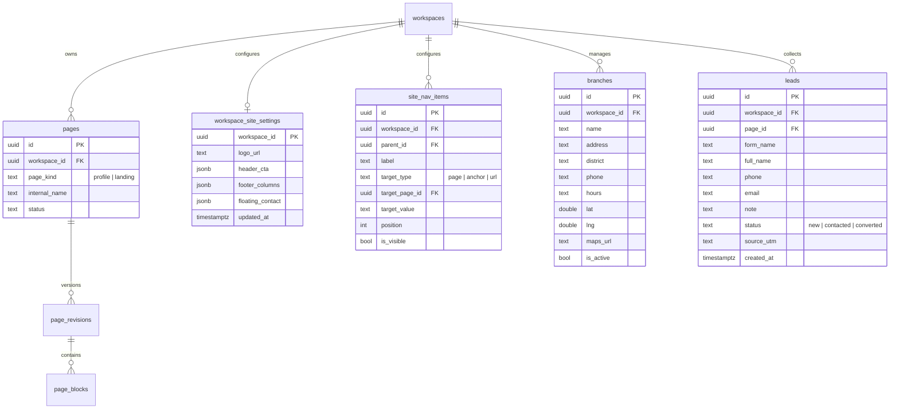

# Đặc tả Tổng thể & Phân tích Kiến trúc: Platform CMS (Trang Profile + Landing Page / Mini-Website)

> **Phiên bản:** 1.0 (Tài liệu tổng hợp chính thức)  
> **Cơ sở xây dựng:** Hợp nhất khảo sát thực tế website `go-cafe.com` (`Trang chủ`, `Nhượng quyền`, `Xưởng rang / Cà phê bột`, `Danh sách chi nhánh`), yêu cầu vận hành trực tiếp từ Gờ Café, và kiến trúc lõi hiện có của `gocafe.profile`.

---

## Mục lục

1. [Bối cảnh, Mục tiêu & Bài toán thực tế](#1-bối-cảnh-mục-tiêu--bài-toán-thực-tế)
2. [Đánh giá Website cũ (`go-cafe.com`) & Khả năng tái sử dụng `gocafe.profile`](#2-đánh-giá-website-cũ-go-cafecom--khả-năng-tái-sử-dụng-gocafeprofile)
3. [Kiến trúc tách biệt 2 loại hình: `Profile` vs `Landing Page`](#3-kiến-trúc-tách-biệt-2-loại-hình-profile-vs-landing-page)
4. [Thiết kế Site Shell dùng chung (Menu 2 cấp, Footer 3 cột, Nút nổi)](#4-thiết-kế-site-shell-dùng-chung-menu-2-cấp-footer-3-cột-nút-nổi)
5. [Hệ thống 9 Section chuẩn hoá & Đặc tả Payload chi tiết](#5-hệ-thống-9-section-chuẩn-hoá--đặc-tả-payload-chi-tiết)
6. [Hệ thống Chi nhánh & Bản đồ tương tác 2 chiều (`store_locator`)](#6-hệ-thống-chi-nhánh--bản-đồ-tương-tác-2-chiều-store_locator)
7. [Thu thập SĐT & Quản lý Khách hàng tiềm năng (`Leads`) — Kỹ thuật & Pháp lý](#7-thu-thập-sđt--quản-lý-khách-hàng-tiềm-năng-leads--kỹ-thuật--pháp-lý)
8. [Design System & Bộ mẫu dựng sẵn (Templates) cho Gờ Café](#8-design-system--bộ-mẫu-dựng-sẵn-templates-cho-gờ-café)
9. [Thiết kế Cơ sở dữ liệu, RLS & Phân quyền](#9-thiết-kế-cơ-sở-dữ-liệu-rls--phân-quyền)
10. [Trải nghiệm Trình biên tập (Editor UX) & Hiệu năng (Caching / SEO)](#10-trải-nghiệm-trình-biên-tập-editor-ux--hiệu-năng-caching--seo)
11. [Đánh giá Rủi ro & Biện pháp kiểm soát](#11-đánh-giá-rủi-ro--biện-pháp-kiểm-soát)
12. [Lộ trình triển khai 5 Giai đoạn & Tiêu chí nghiệm thu](#12-lộ-trình-triển-khai-5-giai-đoạn--tiêu-chí-nghiệm-thu)
13. [Checklist chuyển đổi nội dung từ `go-cafe.com` & Các điểm cần chốt](#13-checklist-chuyển-đổi-nội-dung-từ-go-cafecom--các-điểm-cần-chốt)

---

## 1. Bối cảnh, Mục tiêu & Bài toán thực tế

### 1.1. Tầm nhìn sản phẩm
Nâng cấp `gocafe.profile` từ một ứng dụng quản lý **Trang Profile (Bio Link)** trở thành một **Platform CMS tự cấu hình đa thương hiệu (Multi-workspace)**, cho phép người dùng không chuyên kỹ thuật tự tạo và vận hành song song:
1. **Trang Profile (Bio Link):** Tối ưu cho di động, gắn link bio TikTok / Facebook / Instagram / Shopee và mã QR cá nhân/kênh.
2. **Landing Page / Mini-Website thương hiệu:** Đầy đủ thanh menu nhiều tab, trang giới thiệu, cẩm nang nhượng quyền, bảng báo giá sỉ, bản đồ hệ thống chi nhánh tương tác 2 chiều và form thu thập khách hàng tiềm năng.

### 1.2. Các yêu cầu thực tế từ khách hàng (Gờ Café)
- **Tự chủ hoàn toàn:** *"Làm sao để chị tự thêm tab, tự làm được hết càng tốt"* với 8 mục chính:
  1. Trang chủ
  2. Về chúng tôi
  3. Hệ thống quán
  4. Menu thức uống
  5. Cà phê rang xay
  6. Dành cho chủ quán *(Nhượng quyền / B2B)*
  7. Tuyển dụng
  8. Liên hệ
- **Mẫu dựng sẵn đúng gu:** *"Cho 1 số mẫu chọn trước để đỡ chỉnh tới lui. Gu đơn giản, chữ không đuôi Lexend, tông màu trắng, đen, có điểm vàng đồng."*
- **Bản đồ 55 chi nhánh tương tác 2 chiều:** *"Bấm vào đâu trên bản đồ thì nhảy địa chỉ và thông tin ở đó, có thể search tên đường, quận bên danh sách."*
- **Thu thập SĐT khách hàng:** Nhu cầu nắm bắt thông tin khách quan tâm (nhận mẫu thử, báo giá sỉ, nhượng quyền, ứng tuyển) theo hướng hiệu quả và đúng pháp luật.

---

## 2. Đánh giá Website cũ (`go-cafe.com`) & Khả năng tái sử dụng `gocafe.profile`

### 2.1. Khảo sát 4 trang thực tế trên `go-cafe.com`
Website hiện tại chạy **WordPress + Elementor + WooCommerce** và tồn tại nhiều bất cập:

| Trang khảo sát | Thực trạng kỹ thuật | Vấn đề tồn đọng |
| --- | --- | --- |
| **Trang chủ** (`go-cafe.com/`) | Nặng thư viện WooCommerce & theme nhà hàng | Sót form *"Đặt bàn"* + *"Yêu cầu đặc biệt"* trên mọi trang, `H1: HomePage II`, trong khi bán hàng thực tế đẩy qua Shopee / TikTok / iPOS |
| **Nhượng quyền** (`go-cafe.com/nhuong-quyen/`) | Ghép tay **116 widget Elementor rời rạc** (79 heading, 19 image, 6 icon-list, 6 image-box) | Cực khó tự chỉnh sửa, dễ vỡ layout trên điện thoại khi thay chữ/ảnh |
| **Xưởng rang** (`go-cafe.com/xuong-rang-ca-phe/`) | Dải chỉ số (`TOP 1 Shopee`, `40+ cửa hàng`, `72H`) + Bảng giá sỉ `20KG / 10KG / 5KG` | Chỉnh bảng giá phải sửa HTML/table thủ công trong Elementor |
| **Chi nhánh** (`go-cafe.com/danh-sach-chi-nhanh/`) | Nhúng `<iframe>` Google My Maps tách rời danh sách bên phải | Không tương tác 2 chiều Map ⇄ List, không search tên đường/quận lọc bản đồ |

### 2.2. Mức độ tái sử dụng hạ tầng `gocafe.profile` hiện tại (~75–80%)

| Thành phần đã có trong `gocafe.profile` | Mức độ tái sử dụng | Ghi chú mở rộng |
| --- | --- | --- |
| **Workspace + JWT (`getClaims`) + Hierarchical RBAC (`owner/editor/viewer`) + PostgreSQL RLS** | **100%** | Áp dụng thẳng cho các bảng mới (`site_nav_items`, `branches`, `leads`) |
| **Revision (`draft`/`sealed`) + Optimistic Locking + Auto-save 2s + Undo/Redo + Nhân bản** | **100%** | Landing Page kế thừa nguyên quy trình lưu nháp & xuất bản an toàn |
| **Block Engine (`BLOCK_REGISTRY`, `BLOCK_PAYLOAD_SCHEMAS`, `BlockFrame`)** | **85%** | Bổ sung `scopes: ("profile" \| "landing")[]` và 9 khối Section Landing Page |
| **Theme Tokens v2 (`theme-tokens.ts`) + Google Font `Lexend Deca`** | **90%** | `Lexend Deca` đã được tải sẵn trong `src/app/layout.tsx`; thêm preset *Gờ Minimal Luxury* |
| **Kho Media + Cropper (`Supabase Storage`) + Tracking `/r/{id}` + Báo cáo** | **100%** | Bổ sung tracking gửi Form (`leads`) và UTM attribution |

### 2.3. So sánh tổng thể: WordPress cũ vs Platform CMS mới

| Tiêu chí | WordPress + Elementor cũ | Platform CMS mới (`gocafe.profile` nâng cấp) |
| --- | --- | --- |
| **Tốc độ & SEO** | Nặng plugin, chậm trên 4G mobile | Cực nhanh (Next.js SSR + `"use cache"` + CDN ảnh) |
| **Khả năng tự vận hành** | Sửa tay Elementor dễ hỏng layout | Lắp ghép Section & Template chuẩn — không bao giờ vỡ giao diện |
| **Bản đồ 55 chi nhánh** | Iframe tĩnh, không search/nhảy 2 chiều | Tương tác 2 chiều Map ⇄ List, tìm đường/quận không dấu, phí API 0đ |
| **Thu thập khách hàng** | Form rời rạc, lẫn form đặt bàn cũ | Form chuyên biệt theo mục đích + quản lý tập trung tại `/admin/leads` + xuất Excel |
| **Quản trị đa kênh** | Tách rời 2 hệ thống (Lnk.Bio + WordPress) | **1 nền tảng duy nhất**, dùng chung kho Ảnh, kho Liên kết, Báo cáo & Phân quyền |

---

## 3. Kiến trúc tách biệt 2 loại hình: `Profile` vs `Landing Page`

### 3.1. Phân loại bằng cột `pages.page_kind`
Thêm cột `page_kind text NOT NULL DEFAULT 'profile' CHECK (page_kind IN ('profile', 'landing'))` trên bảng `pages` (toàn bộ trang hiện có tự động là `'profile'`, **không ảnh hưởng dữ liệu cũ**).

| Khía cạnh | Loại 1: Trang Profile (`profile`) | Loại 2: Landing Page (`landing`) |
| --- | --- | --- |
| **Mục đích** | Link bio TikTok/Facebook/Shopee, QR cá nhân/kênh | Website thương hiệu nhiều tab, cẩm nang, báo giá sỉ, chi nhánh |
| **Độ rộng khung render** | Dọc 1 cột (`max-w: 420–620px`) | Full-width Responsive (`max-w: 1200–1280px` Desktop, tự co gọn Mobile) |
| **Site Shell (Navbar / Footer)** | Không có Navbar; có Nhãn chân trang tuỳ chọn (`GỜ CÀFÊ`) | Kế thừa **Navbar 2 cấp** + **Footer 3 cột** + **Nút Zalo/Gọi nổi** của workspace (có công tắc bật/tắt riêng từng trang) |
| **Khung Xem trước (Preview)** | Mặc định Mobile `375px` | Mặc định Desktop `1024–1280px` (chuyển nhanh Desktop / Tablet / Mobile) |
| **Block Picker** | Chỉ hiện khối có scope `profile` | Chỉ hiện khối có scope `landing` |
| **Danh sách `/admin/pages`** | Tab lọc `Tất cả` \| `Profile` \| `Landing Page` + badge nhận diện | Quản lý chung nhưng phân tách rõ ràng |

### 3.2. Luồng tạo trang mới (Wizard 2 bước)
1. **Bước 1 — Chọn loại trang:**
   - **Trang Profile (Bio Link):** Gọn nhẹ, 1 cột di động, đặt link bio & QR.
   - **Landing Page / Website:** Rộng toàn màn hình, có thanh Menu tab, Banner lớn, Bảng giá, Bản đồ, Form đăng ký.
2. **Bước 2 — Chọn mẫu dựng sẵn (Template):**
   - Chọn mẫu có sẵn cấu trúc section, ảnh mẫu, màu sắc chuẩn → bấm **"Dùng mẫu này"** → hệ thống tự sinh toàn bộ khối nội dung để người dùng chỉ việc thay chữ & ảnh.

---

## 4. Thiết kế Site Shell dùng chung (Menu 2 cấp, Footer 3 cột, Nút nổi)

Để chị Ánh có thể **tự thêm/sửa/xoá/kéo thả Tab** và thay đổi 1 lần áp dụng đồng bộ cho tất cả 8 trang con, bổ sung mục **Cấu hình Website (`/admin/site`)** trong Admin:

1. **Thanh Menu điều hướng (`site_nav_items`) — hỗ trợ 2 cấp (Dropdown):**
   - Mỗi mục gồm: `label`, `parent_id` (để tạo menu thả xuống như *Tuyển dụng → Tại cửa hàng / Câu hỏi thường gặp*), `target_type` (`page` \| `anchor` \| `url`), `target_page_id`, `target_value`, `position`, `is_visible`.
   - Hỗ trợ nút **"Tạo trang mới cho tab này"** ngay khi thêm tab để không phải chuyển qua lại nhiều màn hình.
   - Trên Mobile tự động chuyển thành Drawer menu trượt ngang mượt mà.
2. **Cấu hình Header, Footer 3 cột & Nút nổi (`workspace_site_settings`):**
   - **Header:** Logo thương hiệu, kiểu thanh menu (dính trên cùng `sticky`), nút CTA nổi bật bên phải (VD: *Đặt hàng* hoặc *Liên hệ*).
   - **Footer 3 cột:** Cột 1 (*Thông tin công ty*), Cột 2 (*Liên kết nhanh*), Cột 3 (*Liên hệ & Mạng xã hội*) + dòng bản quyền cuối trang.
   - **Cụm nút nổi góc dưới phải (Floating Contact):** Bật/tắt nút **Gọi điện** (mở `PhoneActionSheet`) và nút **Nhắn Zalo**.

---

## 5. Hệ thống 9 Section chuẩn hoá & Đặc tả Payload chi tiết

Mọi khối trong `BLOCK_REGISTRY` được gắn `scopes: ("profile" | "landing")[]` và kiểm tra chặt bằng Zod (`BLOCK_PAYLOAD_SCHEMAS`):

- **Dùng chung (`["profile", "landing"]`):** `heading`, `text`, `image`, `gallery`, `menu_card`, `accordion`, `video_embed`, `button`, `divider`, `spacer`.
- **Riêng Profile (`["profile"]`):** `header`, `link_list`, `social_icons`, `map`.
- **Riêng Landing Page (`["landing"]`):**

| # | Mã khối (`type`) | Tên hiển thị | Ứng dụng thực tế từ `go-cafe.com` | Đặc tả Payload chính |
| --- | --- | --- | --- | --- |
| 1 | `hero_section` | **Banner mở đầu (Hero)** | Mở đầu *Trang chủ*, *Nhượng quyền*, *Xưởng rang* | `anchorId?`, `layout: "split" \| "centered" \| "full-bg"`, `eyebrow?`, `title`, `subtitle?`, `imageUrl?`, `mediaId?`, `primaryCta?: { label, href, linkId? }`, `secondaryCta?` |
| 2 | `toc_bar` | **Mục lục nhảy mục (TOC)** | Thanh mục lục trang *Cẩm nang Nhượng quyền* | `title?`, `sticky?: boolean`, `items: [{ label, anchorId }]` |
| 3 | `stats_strip` | **Dải chỉ số uy tín** | `TOP 1 Shopee (98% 5 sao)`, `55+ Cửa hàng`, `Rang mới 72H` | `anchorId?`, `columns: 3 \| 4`, `items: [{ value, label, sublabel? }]` |
| 4 | `split_content` | **Khối 2 cột Ảnh – Chữ** | Triết lý kinh doanh, Tầm nhìn, Câu chuyện xưởng rang | `anchorId?`, `imagePosition: "left" \| "right"`, `eyebrow?`, `title`, `content` (RichText HTML), `imageUrl?`, `mediaId?`, `cta?` |
| 5 | `info_cards` | **Thẻ thông số / Quy trình** | Thông số quán (*60–150m²*, *Trung cấp*...), *Cam kết*, *Các bước hợp tác* | `anchorId?`, `title?`, `subtitle?`, `columns: 2 \| 3 \| 4`, `variant: "card" \| "steps"`, `items: [{ badge?, title, description }]` |
| 6 | `pricing_table` | **Bảng báo giá đa cột** | *Bảng báo giá sỉ Cà phê bột* (`20KG` \| `10KG` \| `5KG`) | `anchorId?`, `title?`, `effectiveNote?`, `columns: string[]`, `rows: [{ name, subtitle?, description?, prices: string[], highlight?: boolean }]` |
| 7 | `product_grid` | **Lưới sản phẩm / Menu** | *Menu thức uống*, *Danh mục cà phê bột* có lọc nhóm | `anchorId?`, `title?`, `categories: string[]`, `items: [{ name, category, price?, imageUrl?, description?, buyUrl?, badge? }]` |
| 8 | `store_locator` | **Bản đồ hệ thống chi nhánh** | Trang *Hệ thống 55 quán* tương tác 2 chiều | `anchorId?`, `title?`, `subtitle?`, `showSearch: boolean`, `showDistrictFilter: boolean`, `defaultZoom?: number` *(đọc động từ bảng `branches`)* |
| 9 | `lead_form` | **Form thu thập SĐT / Đăng ký** | *Nhận mẫu thử*, *Báo giá sỉ*, *Tư vấn nhượng quyền*, *Ứng tuyển* | `anchorId?`, `formName`, `title`, `subtitle?`, `submitLabel`, `successMessage`, `fields: { showEmail?, showNote?, notePlaceholder? }`, `popupDelaySec?: number` |

---

## 6. Hệ thống Chi nhánh & Bản đồ tương tác 2 chiều (`store_locator`)

### 6.1. So sánh công nghệ bản đồ

| Giải pháp | Tương tác 2 chiều (Map ⇄ List) | Tìm kiếm đường / quận không dấu | Pin logo Gờ tuỳ biến | Chi phí API | Quyết định |
| --- | --- | --- | --- | --- | --- |
| **Google My Maps `<iframe>`** | Không | Không đồng bộ map | Hạn chế | 0đ | Loại |
| **Leaflet + OpenStreetMap (Carto Voyager / Positron)** | **Hoàn hảo 100%** | **Có — lọc tức thì** | **100% (kèm gom cụm Cluster)** | **0đ miễn phí hoàn toàn** | **Chọn (Mặc định)** |
| **Google Maps JavaScript API** | Hoàn hảo 100% | Có | Có | Có phí theo lượt tải | Dự phòng nếu khách yêu cầu riêng |

### 6.2. Trải nghiệm người dùng & Quản trị 55 chi nhánh
- **Trên trang công khai (`store_locator`):**
  - Desktop chia 2 cột: **Trái (60%)** Bản đồ Leaflet với cụm pin tròn đen logo Gờ Café; **Phải (40%)** Ô tìm kiếm (gõ *"Ấp Bắc"*, *"Tân Phú"*, *"320"* không cần dấu) + bộ lọc Quận + danh sách cuộn.
  - **Đồng bộ 2 chiều:** Bấm vào pin trên bản đồ → danh sách bên phải tự cuộn mượt và tô nổi thẻ quán đó; bấm vào thẻ quán bên phải → bản đồ tự `flyTo` phóng to đúng pin quán và mở popup thông tin.
  - Trên mỗi thẻ quán có nút **Chỉ đường Google Maps** và nút **Gọi / Nhắn Zalo** (dùng lại `PhoneActionSheet`).
- **Trong Admin (`/admin/branches`):**
  - Thêm/sửa/ẩn từng chi nhánh (Tên, Địa chỉ, Quận, SĐT, Giờ mở cửa, Link Maps, `lat`, `lng`).
  - **Tiện ích thông minh:** Dán link Google Maps → hệ thống tự tách toạ độ `@lat,lng`; hỗ trợ **Import nhanh CSV/Excel** để nạp 55 quán trong 30 giây.

---

## 7. Thu thập SĐT & Quản lý Khách hàng tiềm năng (`Leads`) — Kỹ thuật & Pháp lý

### 7.1. Ranh giới kỹ thuật & pháp lý cần thống nhất với khách hàng
- **Không thể tự động lấy SĐT** chỉ bằng việc khách mở trang web: trình duyệt (Chrome/Safari) và hệ điều hành (iOS/Android) khoá hoàn toàn truy cập số điện thoại SIM/thiết bị.
- Các dịch vụ "quét SĐT khách vào web" bên ngoài là thu thập dữ liệu trái phép, vi phạm **Nghị định 13/2023/NĐ-CP** về bảo vệ dữ liệu cá nhân và tiềm ẩn rủi ro pháp lý / bị chặn tên miền.

### 7.2. Bộ 3 giải pháp thu thập SĐT hợp pháp & chuyển đổi cao trong CMS
1. **Khối `lead_form` gắn trên trang + Popup ưu đãi tuỳ chọn:**
   - Gắn trực tiếp ở cuối các trang có ý định mua/hợp tác cao (*Nhận mẫu thử cà phê miễn phí*, *Nhận bảng giá sỉ*, *Đăng ký nhượng quyền*, *Ứng tuyển*).
   - Tích hợp chống spam (Honeypot ẩn + Rate limit theo IP + kiểm tra định dạng SĐT Việt Nam).
   - Lưu tập trung tại `/admin/leads`: xem danh sách, lọc theo trang/form/ngày, đánh dấu trạng thái (*Mới / Đã liên hệ / Chốt*), **xuất Excel/CSV**, và tuỳ chọn **gửi thông báo tức thì qua Telegram / Email**.
2. **Tích hợp Zalo OA / Zalo Mini App:**
   - Nếu mở qua **Zalo Mini App**, khách chỉ cần **1 chạm "Cho phép chia sẻ SĐT"** để gửi SĐT chính chủ xác thực từ Zalo (tỷ lệ chuyển đổi cao nhất tại Việt Nam và 100% hợp pháp).
   - Hoặc dẫn về **Zalo OA** để khách bấm Quan tâm và chăm sóc lại qua ZNS / Broadcast.
3. **Đo lường nguồn UTM + Lượt bấm Gọi/Zalo:**
   - Tự động lưu `utm_source / utm_medium / utm_campaign` kèm theo mỗi Lead để biết khách đến từ TikTok, Facebook, Shopee hay QR tại quán.

---

## 8. Design System & Bộ mẫu dựng sẵn (Templates) cho Gờ Café

### 8.1. Preset mặc định: **Gờ Minimal Luxury**
Đáp ứng chính xác gu thẩm mỹ chị Ánh (*đơn giản, chữ không chân Lexend, tông Trắng – Đen – điểm Vàng đồng*):

| Token | Giá trị | Ứng dụng |
| --- | --- | --- |
| **Font Heading & Body** | `Lexend Deca` *(đã load sẵn)* | Không chân, rõ nét tiếng Việt ở mọi cỡ chữ |
| **Nền chính & xen kẽ** | `#FFFFFF` & `#F8F7F4` | Thoáng mắt, phân tách section tự nhiên không cần đường viền nặng |
| **Chữ chính & phụ** | `#111111` & `#52525B` | Độ tương phản cao, sang trọng |
| **Màu nhấn (Accent)** | `#B88A44` (Vàng đồng) | Dùng tiết chế cho nhãn nhỏ, số nổi bật (`TOP 1`, `55+`), giá tiền, viền nhấn & tab active |
| **Nút chính (Primary CTA)** | Nền `#111111`, chữ `#FFFFFF` (hover `#27272A`) | Sắc nét, tối giản, dễ nhận diện |

### 8.2. Bộ 5 mẫu dựng sẵn (Templates) trong Wizard tạo Landing Page
1. **Trang chủ thương hiệu:** Hero Banner + Dải chỉ số + 2 khối Ảnh–Chữ (Về Gờ & Xưởng rang) + Lưới sản phẩm nổi bật + Form liên hệ.
2. **Cẩm nang / Nhượng quyền:** Hero + Mục lục neo (`toc_bar`) + Triết lý 2 cột + Thẻ thông số quán + Quy trình hợp tác + Form đăng ký tư vấn.
3. **Xưởng rang / Báo giá sỉ:** Hero + Dải chỉ số (`TOP 1`, `55+`, `72H`) + Giá trị cốt lõi + **Bảng báo giá đa cột (`20KG / 10KG / 5KG`)** + Cam kết & Quyền lợi + Form nhận mẫu thử.
4. **Hệ thống chi nhánh:** Hero gọn + **Bản đồ 55 quán tương tác 2 chiều (`store_locator`)**.
5. **Trang trống:** Tự lắp ghép section tự do theo nhu cầu.

---

## 9. Thiết kế Cơ sở dữ liệu, RLS & Phân quyền

### 9.1. Sơ đồ quan hệ dữ liệu (ERD)

### 9.2. Nguyên tắc bảo mật & phân quyền (kế thừa RBAC + RLS hiện tại)
- **Đọc công khai (Anon / Public):** Chỉ qua RPC hoặc query read-only giới hạn các bản ghi `is_active = true` / `is_visible = true` thuộc trang đã `published` (tuyệt đối **không** cho public đọc bảng `leads`).
- **Ghi `leads` từ khách truy cập:** Đi qua Server Action / Route Handler chuyên biệt có kiểm tra Zod + Honeypot + Rate Limit (chỉ cho `INSERT`, không lộ dữ liệu).
- **Quản trị Admin:**
  - `viewer`: Xem trang, chi nhánh, menu, danh sách `leads`.
  - `editor`: Tạo/sửa/xuất bản Profile & Landing Page, quản lý Menu tab, quản lý Chi nhánh, cập nhật trạng thái & xuất Excel `leads`.
  - `owner` / Quản trị hệ thống: Toàn quyền + quản lý thành viên & cài đặt workspace.

---

## 10. Trải nghiệm Trình biên tập (Editor UX) & Hiệu năng (Caching / SEO)

- **Editor thích ứng theo `page_kind`:**
  - `profile`: Giữ nguyên giao diện chia 2 cột, khung Preview mặc định Mobile `375px`.
  - `landing`: Khung Preview mặc định Desktop (zoom tự co vừa màn hình để thấy rõ bố cục 2–3 cột), có thanh chuyển nhanh `Desktop (1280px)` / `Tablet (768px)` / `Mobile (375px)`; hỗ trợ thu gọn panel trái để xem toàn màn hình.
  - Kế thừa toàn bộ tính năng đã hoàn thiện: **Auto-save 2 giây**, **Undo/Redo**, **RichTextEditor**, **ImageCropModal**, **Progressive Disclosure**, **Select tuỳ chỉnh**.
- **Hiệu năng & SEO:**
  - Giữ nguyên Next.js `"use cache"` + `revalidateTag(PUBLIC_PAGES_TAG)` cho mọi Landing Page công khai (tốc độ phản hồi cực nhanh, không tốn tải DB).
  - Tự động sinh `sitemap.xml`, `Open Graph (og:title, og:description, og:image)`, chuẩn Heading (`H1` duy nhất từ `hero_section`, `H2/H3` theo từng section) và giữ redirect **308** cho các đường dẫn cũ của `go-cafe.com`.

---

## 11. Đánh giá Rủi ro & Biện pháp kiểm soát

| Rủi ro | Mức độ | Biện pháp kiểm soát |
| --- | --- | --- |
| **Giao diện biên tập bị rối** khi thêm nhiều loại Section | Cao | Tách riêng Block Picker theo `page_kind`, cung cấp 5 Template dựng sẵn, mặc định thu gọn tuỳ chọn nâng cao |
| **Lệch hiển thị bảng giá / bản đồ trên điện thoại** | Trung bình | `pricing_table` có khung cuộn ngang mượt kèm gợi ý vuốt; `store_locator` chuyển sang tab chuyển đổi *Bản đồ / Danh sách* gọn gàng trên mobile |
| **Spam gửi Form `leads`** | Trung bình | Honeypot field ẩn + Rate Limit theo IP + chuẩn hoá & kiểm tra SĐT Việt Nam |
| **Nhập sai toạ độ 55 chi nhánh** | Thấp | Hỗ trợ dán link Google Maps tự tách `lat, lng` + import CSV có bước xem trước lỗi trước khi lưu |
| **Đứt gãy SEO khi chuyển từ `go-cafe.com`** | Trung bình | Tận dụng cơ chế redirect 308 sẵn có của `page_slugs` & `slug-aliases.ts` để giữ nguyên 100% URL cũ |

---

## 12. Lộ trình triển khai 5 Giai đoạn & Tiêu chí nghiệm thu

| Giai đoạn | Hạng mục triển khai | Tiêu chí nghiệm thu (Done) |
| --- | --- | --- |
| **GĐ 1 — Nền tảng tách biệt Profile vs Landing** | Migration thêm `pages.page_kind`, Wizard tạo trang 2 bước (Chọn loại → Chọn mẫu), tab lọc `Profile / Landing` ở `/admin/pages`, Renderer full-width + Preset *Gờ Minimal Luxury (Trắng – Đen – Vàng đồng + Lexend)* | Tạo, sửa, tự động lưu và xuất bản được cả Profile lẫn Landing Page độc lập; Profile cũ hoạt động 100% bình thường |
| **GĐ 2 — Site Shell: Menu 2 cấp & Footer 3 cột** | Migration bảng `site_nav_items` & `workspace_site_settings`, trang `/admin/site` quản lý Tab kéo thả (hỗ trợ dropdown 2 cấp), Navbar dính đầu trang + Footer 3 cột + nút Zalo/Gọi nổi | Người dùng tự thêm/sửa/xoá/kéo thả 8 tab và thấy cập nhật đồng bộ ngay trên mọi Landing Page |
| **GĐ 3 — Bộ Section Landing Page & 4 Template Gờ Café** | Xây dựng 7 khối (`hero_section`, `toc_bar`, `stats_strip`, `split_content`, `info_cards`, `pricing_table`, `product_grid`) + 4 mẫu dựng sẵn | Dựng hoàn chỉnh *Trang chủ*, *Nhượng quyền*, *Xưởng rang (Bảng giá 20kg/10kg/5kg)* đẹp trên cả Desktop & Mobile |
| **GĐ 4 — Hệ thống Chi nhánh & Bản đồ 2 chiều** | Migration bảng `branches`, trang `/admin/branches` (thêm/sửa/ẩn + import CSV 55 quán + tự tách `lat,lng` từ link Maps), khối `store_locator` (Leaflet + tìm đường/quận + đồng bộ Map ⇄ List) | Bấm pin nhảy đúng thẻ quán & bấm thẻ quán bản đồ bay đúng pin; search không dấu theo tên đường/quận hoạt động mượt |
| **GĐ 5 — Thu thập & Quản lý Khách hàng tiềm năng (`Leads`)** | Migration bảng `leads`, khối `lead_form` (+ tuỳ chọn Popup), trang `/admin/leads` (lọc, đổi trạng thái, xuất Excel/CSV), chống spam & tuỳ chọn báo Telegram/Email | Khách gửi form lưu đúng DB kèm nguồn UTM; Admin lọc và xuất Excel mượt mà, chặn được spam |

---

## 13. Checklist chuyển đổi nội dung từ `go-cafe.com` & Các điểm cần chốt

### Checklist chuyển đổi 8 tab nội dung
1. Kích hoạt Preset **Gờ Minimal Luxury** + thiết lập Menu 8 tab & Footer 3 cột.
2. Dựng 4 trang trọng tâm trước: **Trang chủ**, **Cà phê rang xay** *(Bảng giá sỉ)*, **Dành cho chủ quán / Nhượng quyền** *(Mục lục neo + Form)*, **Hệ thống quán** *(Import 55 chi nhánh lên Bản đồ 2 chiều)*.
3. Dựng tiếp 4 trang còn lại: **Về chúng tôi**, **Menu thức uống**, **Tuyển dụng**, **Liên hệ**.
4. Thiết lập SEO (`metaTitle`, `metaDescription`, `ogImage`) và kiểm tra chuyển hướng 308 giữ nguyên các URL cũ từ `go-cafe.com`.

### 3 quyết định cần chốt trước khi khởi động GĐ 1
1. **Tên miền & cấu trúc URL:** Dùng chung domain hiện tại dạng `/<slug>` (VD: `/nhuong-quyen`, `/xuong-rang-ca-phe`, `/he-thong-quan`) hay trỏ trực tiếp domain `go-cafe.com` về hệ thống mới?
2. **Bản đồ chi nhánh:** Chốt sử dụng **Leaflet + OpenStreetMap** (miễn phí 100%, tương tác 2 chiều đầy đủ, pin logo Gờ) hay cần tích hợp **Google Maps API** (có phí)?
3. **Nhịp triển khai:** Thực hiện tuần tự **GĐ 1 → GĐ 5** (ưu tiên xong sớm GĐ 1–3 để có bản mẫu *Trang chủ / Nhượng quyền / Xưởng rang* cho chị Ánh duyệt ngay) đúng không?
