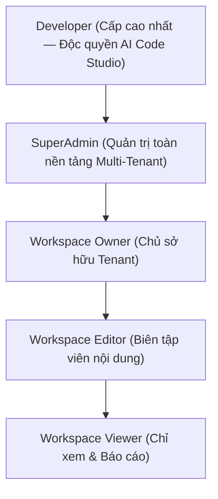

# Phân tích Chi tiết: Tích hợp AI Code Studio (IDE + AI Gen) & Phân quyền Độc quyền `Developer`

> **Dự án:** `gocafe.profile` (Platform CMS Dual-Mode + Multi-Tenant + SuperAdmin)  
> **Ngày lập:** 2026-11-25  
> **Phạm vi:** Thiết kế hệ thống **IDE nhúng tích hợp AI sinh code trực tiếp trên nền tảng (AI Code Studio)** và nâng cấp mô hình phân quyền lên **5 cấp** với tài khoản **`Developer`** (ngang quyền `SuperAdmin` ở mọi chức năng quản trị + độc quyền sở hữu `AI Code Studio`).  
> **Nguyên tắc triển khai:** 100% **0-downtime** đối với Production đang chạy, không ảnh hưởng dữ liệu 12 trang / 343 khối / 72 ảnh thật, cô lập hoàn toàn hiệu năng (không làm nặng trang công khai).

---

## 1. Tổng quan & Mục tiêu Kiến trúc

### 1.1. Bài toán thực tế

Hiện tại, hệ thống đã có đủ bộ công cụ No-Code (26 loại khối, Block Design System v3, Multi-Site Shell, Dynamic Lead Form, Custom Templates). Tuy nhiên, khi cần:

- Tạo nhanh các **hiệu ứng giao diện độc quyền** (hover 3D, animation phức tạp, bố cục phá cách) mà không cần sửa source code rồi commit/deploy lại Vercel;
- Dựng nhanh **widget tương tác đặc thù** (VD: _máy tính hoàn vốn nhượng quyền có thanh trượt, bảng tính chiết khấu sỉ, vòng quay ưu đãi, hiệu ứng chữ chuyển động_);
- Dùng **AI tạo/chỉnh sửa trực tiếp giao diện theo nhiều vòng chat** ngay trên trình duyệt (giống v0 / Framer AI / Antigravity thu nhỏ chuyên cho UI), bấm **Xuất bản** là chạy thật sau 1 giây;

…thì việc nhúng **AI Code Studio (Monaco Editor + Chat AI + Live Preview Sandbox)** ngay trong CMS là lời giải tối ưu.

### 1.2. Tại sao phải tách riêng cấp quyền `Developer` cao hơn `SuperAdmin`?

- **SuperAdmin** là người vận hành kinh doanh/khách hàng (tạo Workspace, cấp tài khoản, bật gói tính năng, gắn tên miền, xem nhật ký). SuperAdmin **không cần** và **không nên** chạm vào mã nguồn CSS/HTML/JS hay gọi AI sinh code tùy ý (tránh rủi ro làm vỡ layout hoặc tốn chi phí API).
- **Developer** (duy nhất 1 tài khoản kỹ thuật chủ chốt hoặc danh sách rất hạn chế) cần:
  1. **Toàn quyền ngang bằng SuperAdmin** (truy cập mọi Workspace, quản lý Users/Domains/Audit Logs để hỗ trợ kỹ thuật trên bất kỳ Tenant nào).
  2. **Độc quyền sử dụng `AI Code Studio`** (Custom CSS toàn Site/Trang, Khối Custom Code HTML/CSS/JS, JSON Inspector, Chat AI Gen Code & AI Page Builder).
  3. **Được bảo vệ trước SuperAdmin:** Tài khoản `SuperAdmin` thông thường **không thể** khóa (`ban`), đổi mật khẩu, gỡ quyền của `Developer` hoặc tự nâng chính mình lên `Developer`.

---

## 2. Mô hình Phân quyền 5 Cấp (RBAC) & Chống Leo thang Đặc quyền



### 2.1. Ma trận Quyền chi tiết

| Nhóm chức năng                                                | Viewer | Editor | Owner |     SuperAdmin      |   **Developer**   |
| ------------------------------------------------------------- | :----: | :----: | :---: | :-----------------: | :---------------: |
| Xem trang, Báo cáo, Leads trong Workspace của mình            |   Có   |   Có   |  Có   |    Toàn hệ thống    | **Toàn hệ thống** |
| Tạo/sửa/xuất bản trang, Site Shell, Chi nhánh, Leads          | Không  |   Có   |  Có   |    Toàn hệ thống    | **Toàn hệ thống** |
| Mời/gỡ thành viên trong Workspace                             | Không  | Không  |  Có   |    Toàn hệ thống    | **Toàn hệ thống** |
| Trung tâm `/admin/system` (Workspaces, Users, Domains, Audit) | Không  | Không  | Không |         Có          |      **Có**       |
| Quản lý / Khóa / Đổi mật khẩu tài khoản `SuperAdmin`          | Không  | Không  | Không | Có _(trừ bản thân)_ |      **Có**       |
| Khóa / Đổi mật khẩu / Gỡ quyền tài khoản `Developer`          | Không  | Không  | Không |     **BỊ CHẶN**     | **Chỉ Developer** |
| Mở **AI Code Studio** (Monaco IDE, Custom CSS, JSON Editor)   | Không  | Không  | Không |     **BỊ CHẶN**     |   **ĐỘC QUYỀN**   |
| Thêm / Sửa khối **`custom_code` (HTML/CSS/JS Sandbox)**       | Không  | Không  | Không |     **BỊ CHẶN**     |   **ĐỘC QUYỀN**   |
| Gọi API **AI Gen UI (`/api/developer/ai-studio`)**            | Không  | Không  | Không |     **BỊ CHẶN**     |   **ĐỘC QUYỀN**   |

### 2.2. Nguyên tắc Chống Leo thang Đặc quyền (Anti-Privilege Escalation)

1. **Chặn 4 lớp đồng thời:** UI ẩn hoàn toàn nút mở IDE + Server Component kiểm tra `ctx.isDeveloper` + Server Action/API Route trả `403 Forbidden` + DB Trigger/RLS kiểm tra `private.is_developer()`.
2. **Bảo vệ tài khoản Developer trong `users-actions.ts`:**
   - Trong `togglePlatformUserBanAction`, `resetPlatformUserPasswordAction`, `toggleSuperAdminAction`: luôn kiểm tra nếu `targetUser` có `platform_role = 'developer'` mà người thao tác không phải `Developer` → **từ chối ngay (`403`)** và ghi vết vào `platform_audit_logs`.
3. **Bảo vệ khối `custom_code` khi Editor/Owner sửa trang:**
   - Nếu `Developer` đã chèn 1 khối `custom_code` vào trang của 1 Tenant, sau đó `Editor`/`Owner`/`SuperAdmin` vào sửa chữ các khối khác trên cùng trang đó:
     - Trên UI, khối `custom_code` hiển thị ở chế độ **chỉ đọc (Khóa bởi Developer — chỉ có thể giữ nguyên hoặc ẩn/di chuyển vị trí, không thể sửa mã bên trong)**.
     - Ở Backend (`saveDraftAction`): nếu người lưu không phải `Developer`, hệ thống kiểm tra mã `html/css/js` của mọi khối `custom_code` phải **khớp nguyên văn** với bản hiện có trong DB (ngăn chặn hành vi dùng DevTools giả mạo request để chèn JS độc hại!).

---

## 3. Thiết kế Database (100% 0-downtime Migration)

### 3.1. Mở rộng bảng `public.admin_users`

```sql
ALTER TABLE public.admin_users
  ADD COLUMN IF NOT EXISTS platform_role text NOT NULL DEFAULT 'superadmin'
    CHECK (platform_role IN ('superadmin', 'developer'));

-- Hàm kiểm tra quyền Developer (chỉ user is_active = true AND platform_role = 'developer')
CREATE OR REPLACE FUNCTION private.is_developer()
RETURNS boolean
LANGUAGE sql
STABLE
SECURITY DEFINER
SET search_path = ''
AS $$
  SELECT EXISTS (
    SELECT 1
    FROM public.admin_users
    WHERE user_id = auth.uid()
      AND is_active = true
      AND platform_role = 'developer'
  );
$$;
```

- **Tương thích ngược 100%:** Hàm `private.is_active_admin()` hiện tại kiểm tra `is_active = true` (không phụ thuộc `platform_role`), do đó tài khoản `Developer` **tự động kế thừa toàn bộ quyền RLS của `SuperAdmin`** trên tất cả 15+ bảng hiện có mà không phải sửa lại bất kỳ policy cũ nào!
- **Cấp quyền Developer cho đúng 1 tài khoản duy nhất:** Thực hiện qua SQL migration / Supabase SQL Editor (`UPDATE public.admin_users SET platform_role = 'developer' WHERE user_id = '<DEVELOPER_UUID>';`) — không mở nút tự nâng cấp cho SuperAdmin trên giao diện web.

### 3.2. Mở rộng loại khối `custom_code` & Nơi lưu Custom CSS

1. **Khối `custom_code`:** Mở rộng ràng buộc `CHECK (type IN (...))` trên `public.page_blocks` từ 26 lên **27 loại khối** (`'custom_code'`).
   - Payload lưu trong `page_blocks.payload` (JSONB):
     ```ts
     export interface CustomCodeBlockPayload {
       title?: string; // Tên widget hiển thị trong Editor (VD: "Máy tính lợi nhuận")
       html?: string; // Tối đa 30.000 ký tự
       css?: string; // Tối đa 20.000 ký tự
       js?: string; // Tối đa 30.000 ký tự
       heightMode?: "auto" | "fixed";
       fixedHeightPx?: number; // 120..2000px (mặc định auto-resize qua postMessage)
       useTailwindCdn?: boolean; // Cho phép dùng class Tailwind trực tiếp trong HTML sinh bởi AI
       anchorId?: string;
     }
     ```
2. **Custom CSS toàn Site & Riêng từng Trang (0 cột DB mới):**
   - Toàn Site Shell: lưu tại `site_shells.header_config.customCss` (chuỗi CSS tối đa 25.000 ký tự, tự động lọc an toàn).
   - Riêng từng Trang: lưu tại `page_revisions.theme.customCss` (đi theo từng phiên bản nháp/xuất bản nên có sẵn **Lịch sử phiên bản & Khôi phục 1 click**!).
3. **Bảng `public.ai_code_logs` (theo dõi lịch sử sinh code & chi phí AI):**
   - Cột: `id`, `developer_user_id`, `workspace_id`, `page_id`, `mode` (`custom_code | custom_css | page_blocks`), `model`, `prompt`, `tokens_in`, `tokens_out`, `created_at`.
   - RLS: Chỉ `private.is_developer()` được đọc; ghi qua `service_role`.

---

## 4. Kiến trúc AI Code Studio (IDE + Chat AI + Live Preview)

### 4.1. Giao diện 3 Khung chuyên nghiệp (Lazy-Loaded)

Chỉ tải thư viện **`@monaco-editor/react`** (lõi VS Code) bằng `dynamic(() => import(...), { ssr: false })` khi `Developer` bấm nút **"Code Studio"** trên thanh công cụ `PageEditor` hoặc `/admin/site` → **0 KB ảnh hưởng đến trang công khai và 0 KB ảnh hưởng đến người dùng thường**.

```
┌──────────────────────────┬─────────────────────────────────┬─────────────────────────────┐
│   1. CHAT AI ASSISTANT   │   2. MONACO CODE IDE (VS Code)  │   3. LIVE PREVIEW SANDBOX   │
│                          │                                 │                             │
│  [Model: Gemini 2.5]     │  [HTML] [CSS] [JS] [JSON]       │  [Mobile | Tablet | Desktop]│
│  [Mode: Widget / CSS /   │                                 │                             │
│         Cả trang Blocks] │  1 | <div class="calc-card">    │  ┌───────────────────────┐  │
│                          │  2 |   <h3>Tính lợi nhuận</h3>  │  │  Tính lợi nhuận quán  │  │
│  User: Tạo máy tính hoàn │  3 |   <input type="range" ...  │  │  Số ly/ngày: [===o--] │  │
│  vốn nhượng quyền có     │  4 | </div>                     │  │  Lợi nhuận: 42tr/tháng│  │
│  thanh trượt số ly/ngày  │                                 │  └───────────────────────┘  │
│                          │                                 │                             │
│  AI: Đã tạo widget...    │  [Áp dụng vào khối] [Định dạng] │  [Auto-height: 340px]       │
│  [Nhập lệnh sửa tiếp...] │  [Snippet mẫu ▾]    [Hoàn tác]  │  [Console: 0 lỗi]           │
└──────────────────────────┴─────────────────────────────────┴─────────────────────────────┘
```

### 4.2. Chi tiết 3 Chế độ làm việc trong AI Code Studio

1. **Chế độ A — Widget IDE (`custom_code`: HTML + CSS + JS):**
   - Dùng để tạo mọi thành phần UI/tương tác không có sẵn trong 26 khối cơ bản.
   - AI nhận: `prompt mới` + `lịch sử hội thoại` + `code HTML/CSS/JS hiện tại trong IDE` + `bảng màu/font của trang hiện tại` (`--gp-accent`, `--gp-bg`, `--gp-text`, `--gp-font-heading`).
   - AI trả về JSON chuẩn (`{ explanation, html, css, js }`) → đổ thẳng vào 3 tab Monaco → Live Preview cập nhật ngay trong iframe sandbox!
   - Có **Console mini** ngay dưới Preview để bắt lỗi `window.onerror` / `console.error` trong iframe giúp Developer debug nhanh (thậm chí có nút **"Nhờ AI sửa lỗi này"** 1 click!).

2. **Chế độ B — Custom CSS Studio (Toàn Site & Riêng từng Trang):**
   - Cho phép tùy chỉnh mọi chi tiết vi mô của Navbar, Footer, Hero, Product Grid, Buttons bằng CSS thuần.
   - Có **bảng tra cứu nhanh CSS Variables & Class Hooks** ngay cạnh editor (`.gp-page-scope`, `--gp-accent`, `--gp-font-heading`, `--gp-btn-bg`...).
   - Hỗ trợ Chat AI: _"Làm cho mọi nút trên trang có hiệu ứng ánh sáng lướt qua khi rê chuột và bo tròn kiểu kính mờ"_.

3. **Chế độ C — AI Page Generator (Prompt → Mảng `blocks[]` của CMS):**
   - Gõ 1 đoạn mô tả chiến dịch → AI sinh ra mảng JSON các khối chuẩn theo đúng `BLOCK_PAYLOAD_SCHEMAS` (Hero, Stats, Split Content, Product Grid, Testimonials, Pricing, Lead Form).
   - Server kiểm chứng lại toàn bộ mảng bằng **Zod schema** trước khi trả về client → nạp trực tiếp vào `PageEditor` (có hỗ trợ `Ctrl+Z` hoàn tác) để sau đó cả **Editor / Owner** không biết code cũng có thể tự sửa chữ & đổi ảnh trên chính trang AI vừa dựng!

### 4.3. Thiết kế API Route `POST /api/developer/ai-studio`

- **Xác thực bắt buộc:** Gọi `getWorkspaceContext()` → kiểm tra `ctx?.isDeveloper === true`; nếu sai trả ngay **`403 Forbidden`**.
- **Model AI đề xuất:**
  - Mặc định: **`gemini-2.5-flash`** (tốc độ phản hồi 2–4 giây, hỗ trợ Structured JSON Output chuẩn xác, chi phí cực thấp — ~\$0.001–\$0.003 mỗi lượt gen).
  - Tùy chọn nâng cao: **`gemini-2.5-pro`** (cho widget tương tác phức tạp / logic tính toán nhiều bước).
- **Biến môi trường (chỉ ở Server / Vercel):**
  - `GEMINI_API_KEY`: API key lấy từ Google AI Studio (tuyệt đối không có tiền tố `NEXT_PUBLIC_`).
- **Xử lý đầu ra an toàn:**
  - Dùng `responseMimeType: "application/json"` + schema bắt buộc để AI không bao giờ trả markdown vỡ format.
  - Validate kết quả bằng Zod trước khi trả về UI và ghi log vào `public.ai_code_logs`.

---

## 5. Kiến trúc Bảo mật Sandbox & Chống XSS

| Mối đe dọa                                                                 | Biện pháp phòng vệ bắt buộc                                                                                                                                                                                                              |
| -------------------------------------------------------------------------- | ---------------------------------------------------------------------------------------------------------------------------------------------------------------------------------------------------------------------------------------- |
| **JS trong `custom_code` đọc cookie đăng nhập / gọi API nội bộ**           | Render 100% qua `<iframe sandbox="allow-scripts allow-forms allow-popups">` — **TUYỆT ĐỐI KHÔNG cấp `allow-same-origin`**. Iframe có `origin = null` nên không thể chạm vào `localStorage`, `document.cookie` hay DOM của trang cha.     |
| **Custom CSS tiêm mã độc (`@import`, `javascript:`, phá giao diện Admin)** | Hàm `sanitizeCustomCss()` trên cả Server & Renderer: loại bỏ `@import`, `expression(`, `javascript:`, `behavior:`, `</style>` và giới hạn 25.000 ký tự. Ở chế độ Preview trong Editor, chỉ gắn CSS vào container `.gp-page-scope`.       |
| **Iframe bị cắt chiều cao hoặc tạo thanh cuộn xấu**                        | Nhúng sẵn 1 đoạn script nhỏ 15 dòng ở cuối `srcDoc` dùng `ResizeObserver` gửi `window.parent.postMessage({ type: "gp-sandbox-height", id, height }, "*")` để khung cha tự giãn mượt theo đúng chiều cao thực (kẹp trong `60px..3000px`). |
| **Lộ API Key Gemini ra trình duyệt**                                       | `GEMINI_API_KEY` chỉ đọc trong Route Handler server-side (`/api/developer/ai-studio`).                                                                                                                                                   |
| **SuperAdmin / Editor sửa lén code của Developer**                         | Backend `saveDraftAction` và `saveSiteSettingsAction` từ chối mọi thay đổi lên `custom_code` payload hoặc `customCss` nếu `!ctx.isDeveloper`.                                                                                            |

---

## 6. Ảnh hưởng Hiệu năng & Chi phí

- **Tốc độ trang công khai (Public Pages):**
  - Trang không dùng khối `custom_code`: **0 ms ảnh hưởng**.
  - Trang có khối `custom_code`: chỉ render thẻ `<iframe srcDoc="..." loading="lazy" />`, không tải Monaco Editor hay bất kỳ thư viện nặng nào.
- **Tốc độ trang Admin:**
  - Monaco Editor chỉ tải khi `Developer` bấm mở modal/panel **Code Studio** (Dynamic Import `ssr: false`).
- **Chi phí AI:**
  - Dùng `gemini-2.5-flash` trên Google AI Studio có hạn mức miễn phí hàng ngày rất rộng; ở gói trả phí chỉ tốn khoảng **20–60 VNĐ / lượt tạo widget**.

---

## 7. Lộ trình Triển khai Đề xuất (3 Chặng — Nghiệm thu từng chặng trên Local Docker DB)

### Chặng DEV-1 — Hạ tầng Quyền `Developer` & Bảo vệ Chống Leo thang

- Tạo migration `20261125000001_developer_role_and_code_studio.sql`:
  - Thêm `admin_users.platform_role` (`superadmin | developer`), hàm `private.is_developer()`.
  - Mở rộng `page_blocks.type` thêm `'custom_code'`.
  - Tạo bảng `public.ai_code_logs` kèm RLS chỉ cho `private.is_developer()`.
- Cập nhật `WorkspaceContext` (`isDeveloper: boolean`), cập nhật `users-actions.ts` bảo vệ tài khoản `Developer` khỏi `SuperAdmin`, và thêm badge **`Developer`** trong Sidebar + `/admin/system`.
- Viết unit test + RLS smoke test xác nhận: `SuperAdmin` bị chặn khỏi `ai_code_logs` và không thể khóa/sửa quyền `Developer`.

### Chặng DEV-2 — Monaco Code Studio (Custom CSS + Khối `custom_code` Sandbox + JSON Inspector)

- Cài `@monaco-editor/react`.
- Xây dựng renderer `CustomCodeBlock` (`<iframe sandbox="allow-scripts allow-forms allow-popups">` + `ResizeObserver` auto-height + console error bridge) và `sanitizeCustomCss()`.
- Tích hợp nút **"Code Studio"** (chỉ hiện với `ctx.isDeveloper`) trong `PageEditor` và `/admin/site` (chỉnh Custom CSS toàn Site/Trang, sửa khối `custom_code` 3 tab HTML/CSS/JS, và JSON Inspector).
- Khóa chế độ chỉ đọc cho khối `custom_code` khi non-Developer mở trang + bảo vệ ở `saveDraftAction`.

### Chặng DEV-3 — Tích hợp AI Gen (Chat nhiều vòng Gemini + AI Page Builder + Snippet Library)

- Xây dựng API `POST /api/developer/ai-studio` kết nối Gemini API (`gemini-2.5-flash` / `gemini-2.5-pro`) với System Prompt chuẩn Design System của Platform + lưu log `ai_code_logs`.
- Xây dựng khung **Chat AI nhiều vòng** ngay bên trái Monaco IDE: hỗ trợ tạo mới, chỉnh sửa code đang mở, nút **"Nhờ AI sửa lỗi"** khi iframe báo lỗi console, và chế độ **AI dựng cả trang Landing Page (Blocks JSON)**.
- Bổ sung 4 Snippet mẫu sẵn có (Máy tính lợi nhuận nhượng quyền, Bảng so sánh tương tác, Đồng hồ đếm ngược khai trương, Dải logo chạy ngang).
- Kiểm chứng tổng thể (`db:reset`, `typecheck`, `lint`, toàn bộ `vitest`, `pnpm build`) & bàn giao hướng dẫn kích hoạt quyền `Developer` trên Production.

---

_Tài liệu phân tích đã hoàn tất. Khi bạn duyệt kiến trúc này, mình sẽ tạo file checklist `docs/checklist-trien-khai-ai-code-studio-developer.md` và bắt đầu triển khai từng chặng từ **DEV-1** trên Local Docker DB._
