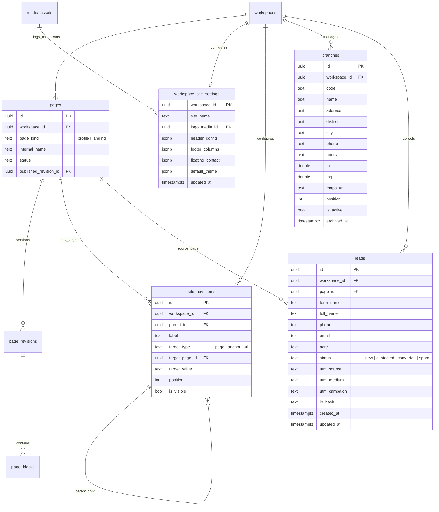

# Phân tích & Đặc tả Thiết kế Database: Nâng cấp Platform CMS (`Profile` + `Landing Page`)

> **Dự án:** `gocafe.profile` (PostgreSQL 17 / Supabase)  
> **Phạm vi:** Mở rộng cơ sở dữ liệu hiện tại từ hệ thống Bio Link (`profile`) sang Platform CMS đa thương hiệu hỗ trợ song song **Trang Profile** và **Landing Page / Mini-Website** (Menu 2 cấp, Footer 3 cột, Bản đồ 55+ chi nhánh tương tác 2 chiều, Quản lý Leads hợp pháp).  
> **Môi trường phát triển:** Cô lập 100% trên **Supabase Local (Docker)**, bảo đảm **0-downtime & tương thích ngược 100%** khi áp dụng lên Production Cloud.

---

## 1. Đánh giá Hiện trạng DB & Mức độ Tái sử dụng (~80%)

Hệ thống hiện tại gồm **12 file migration** (`20261106000001` → `20261117000002`) với **16 bảng cốt lõi**:

- **Định danh & Multi-workspace:** `workspaces`, `workspace_members`, `workspace_invitations`, `admin_users`, `reserved_slugs`
- **Nội dung & Versioning:** `pages`, `page_slugs`, `page_revisions`, `page_blocks`, `theme_presets`
- **Liên kết, Media & Thống kê:** `links`, `page_links`, `revision_link_placements`, `media_assets`, `revision_media_assets`, `click_events`

### Các cơ chế nền tảng tái sử dụng trực tiếp 100%

| Cơ chế hiện có trong DB                  | Hàm / Trigger nguồn                                                                                                           | Lợi ích khi nâng cấp Landing Page                                                                                            |
| ---------------------------------------- | ----------------------------------------------------------------------------------------------------------------------------- | ---------------------------------------------------------------------------------------------------------------------------- |
| **Phân quyền theo Workspace**            | `private.is_active_admin()`, `private.workspace_role(ws)`, `private.can_read_workspace(ws)`, `private.can_edit_workspace(ws)` | Áp dụng thẳng cho toàn bộ 4 bảng mới (`workspace_site_settings`, `site_nav_items`, `branches`, `leads`).                     |
| **Chống đổi Workspace trái phép**        | `public.check_workspace_immutable()`                                                                                          | Gắn vào mọi bảng mới để khóa cứng `workspace_id` sau khi tạo.                                                                |
| **Revision bất biến (`draft`/`sealed`)** | `check_sealed_revision_immutability()`, `check_child_of_sealed_revision()`, `check_published_revision_is_sealed()`            | Landing Page thừa hưởng nguyên quy trình lưu nháp 2s, Undo/Redo, nhân bản và xuất bản không gián đoạn.                       |
| **Tự động khóa ảnh đang sử dụng**        | `private.revision_media_ids(rev_id)` _(dùng `jsonb_path_query(b.payload, 'strict $.**')`)_                                    | Tự động quét mọi URL/ID ảnh trong **9 section Landing Page mới** để chống xóa nhầm trong kho Media mà không cần sửa trigger. |
| **Chuẩn hóa `updated_at`**               | `public.set_current_timestamp_updated_at()`                                                                                   | Dùng chung cho mọi bảng mới.                                                                                                 |

---

## 2. Sơ đồ Quan hệ Dữ liệu Mở rộng (ERD)



---

## 3. Chi tiết Thay đổi trên 2 Bảng Hiện có (Tương thích ngược 100%)

### 3.1. Bảng `public.pages`

- **Thêm cột:**
  ```sql
  ALTER TABLE public.pages
    ADD COLUMN IF NOT EXISTS page_kind text NOT NULL DEFAULT 'profile'
    CHECK (page_kind IN ('profile', 'landing'));

  CREATE INDEX IF NOT EXISTS idx_pages_workspace_kind_active
    ON public.pages (workspace_id, page_kind)
    WHERE archived_at IS NULL;
  ```
- **Tác động Production:** Bằng 0. Toàn bộ trang Profile đang chạy tự động nhận giá trị `'profile'`.

### 3.2. Bảng `public.page_blocks`

- **Mở rộng `CHECK` constraint cột `type`:** Giữ nguyên 14 loại khối cũ + bổ sung **9 loại khối Section Landing Page**:
  - `hero_section`, `toc_bar`, `stats_strip`, `split_content`, `info_cards`, `pricing_table`, `product_grid`, `store_locator`, `lead_form`.
- **Cách thực hiện an toàn:** Xóa động mọi constraint cũ liên quan tới `type` bằng khối `DO $$` (giống mẫu đã chạy thành công ở `20261116000002_block_types_v2.sql`), sau đó tạo lại `page_blocks_type_check` mới với đủ **23 loại khối**.

---

## 4. Đặc tả Chi tiết 4 Bảng Mới

### 4.1. `public.workspace_site_settings` (Site Shell dùng chung)

Quan hệ **1–1** với `workspaces`, lưu cấu hình Navbar, Footer 3 cột, nút nổi Zalo/Gọi và theme mặc định cho toàn bộ Landing Page trong cùng workspace.

| Cột                | Kiểu dữ liệu  | Ràng buộc / Mặc định                                                | Mục đích                                                  |
| ------------------ | ------------- | ------------------------------------------------------------------- | --------------------------------------------------------- |
| `workspace_id`     | `uuid`        | `PRIMARY KEY REFERENCES public.workspaces(id) ON DELETE CASCADE`    | Khóa chính 1–1 với workspace                              |
| `site_name`        | `text`        | `CHECK (site_name IS NULL OR length(trim(site_name)) <= 120)`       | Tên thương hiệu hiển thị trên Header/Footer               |
| `logo_media_id`    | `uuid`        | `REFERENCES public.media_assets(id) ON DELETE RESTRICT`             | Khóa ngoại tới kho Media giúp **chống xóa nhầm ảnh logo** |
| `header_config`    | `jsonb`       | `NOT NULL DEFAULT '{}'::jsonb CHECK (jsonb_typeof(...) = 'object')` | `{ sticky: true, cta: { label, href, enabled } }`         |
| `footer_columns`   | `jsonb`       | `NOT NULL DEFAULT '[]'::jsonb CHECK (jsonb_typeof(...) = 'array')`  | Mảng tối đa 3 cột footer + thông tin bản quyền            |
| `floating_contact` | `jsonb`       | `NOT NULL DEFAULT '{}'::jsonb CHECK (jsonb_typeof(...) = 'object')` | `{ enabled, phone, zaloUrl, showCall, showZalo }`         |
| `default_theme`    | `jsonb`       | `NOT NULL DEFAULT '{}'::jsonb CHECK (jsonb_typeof(...) = 'object')` | Preset mặc định cho trang mới (VD: `go-minimal-luxury`)   |
| `updated_at`       | `timestamptz` | `NOT NULL DEFAULT now()`                                            | Tự động cập nhật qua trigger                              |

- **Trigger bảo vệ chéo workspace:** Kiểm tra nếu `logo_media_id IS NOT NULL` thì `media_assets.workspace_id = NEW.workspace_id`.

---

### 4.2. `public.site_nav_items` (Thanh Menu 2 cấp tự quản lý)

Cho phép người quản trị tự thêm/sửa/xóa/kéo thả các tab (_Trang chủ, Về chúng tôi, Hệ thống quán, Menu, Cà phê rang xay, Nhượng quyền, Tuyển dụng, Liên hệ_) và tạo menu thả xuống 2 cấp.

| Cột                         | Kiểu dữ liệu  | Ràng buộc / Mặc định                                          | Mục đích                                       |
| --------------------------- | ------------- | ------------------------------------------------------------- | ---------------------------------------------- |
| `id`                        | `uuid`        | `PRIMARY KEY DEFAULT gen_random_uuid()`                       | Khóa chính                                     |
| `workspace_id`              | `uuid`        | `NOT NULL REFERENCES public.workspaces(id) ON DELETE CASCADE` | Sở hữu theo workspace                          |
| `parent_id`                 | `uuid`        | `REFERENCES public.site_nav_items(id) ON DELETE CASCADE`      | `NULL` = Tab cấp 1; có giá trị = Mục con cấp 2 |
| `label`                     | `text`        | `NOT NULL CHECK (length(trim(label)) BETWEEN 1 AND 60)`       | Tên hiển thị trên thanh Menu                   |
| `target_type`               | `text`        | `NOT NULL CHECK (target_type IN ('page', 'anchor', 'url'))`   | Loại đích đến                                  |
| `target_page_id`            | `uuid`        | `REFERENCES public.pages(id) ON DELETE SET NULL`              | Dùng khi `target_type = 'page'`                |
| `target_value`              | `text`        | `NULL` (hoặc `#section-id` / `https://...`)                   | Dùng khi `target_type IN ('anchor', 'url')`    |
| `position`                  | `integer`     | `NOT NULL DEFAULT 0 CHECK (position >= 0)`                    | Thứ tự hiển thị kéo thả                        |
| `is_visible`                | `boolean`     | `NOT NULL DEFAULT true`                                       | Ẩn/hiện nhanh từng tab                         |
| `created_at` / `updated_at` | `timestamptz` | `NOT NULL DEFAULT now()`                                      | Dấu thời gian                                  |

- **Ràng buộc & Trigger bắt buộc (Edge cases):**
  1. `CHECK (parent_id IS DISTINCT FROM id)` — chặn tự trỏ vào chính mình.
  2. `CHECK ((target_type = 'page' AND target_page_id IS NOT NULL) OR (target_type IN ('anchor', 'url') AND length(trim(coalesce(target_value, ''))) > 0))` — đảm bảo không có tab rỗng đích.
  3. **Trigger `check_site_nav_item_integrity()`:**
     - Nếu `parent_id IS NOT NULL`: xác nhận mục cha thuộc **cùng `workspace_id`** và mục cha phải có `parent_id IS NULL` (**giới hạn tối đa 2 cấp**, không cho tạo cấp 3 làm vỡ Navbar).
     - Nếu `target_page_id IS NOT NULL`: xác nhận `pages.workspace_id = NEW.workspace_id` (chống trỏ sang trang của workspace khác).
- **Index:** `idx_site_nav_items_ws_order ON public.site_nav_items (workspace_id, parent_id, position)`.

---

### 4.3. `public.branches` (Hệ thống 55+ Chi nhánh & Bản đồ 2 chiều)

Quản lý tập trung toàn bộ chi nhánh để khối `store_locator` đọc động và đồng bộ 2 chiều Map ⇄ List.

| Cột                         | Kiểu dữ liệu       | Ràng buộc / Mặc định                                          | Mục đích                                           |
| --------------------------- | ------------------ | ------------------------------------------------------------- | -------------------------------------------------- |
| `id`                        | `uuid`             | `PRIMARY KEY DEFAULT gen_random_uuid()`                       | Khóa chính                                         |
| `workspace_id`              | `uuid`             | `NOT NULL REFERENCES public.workspaces(id) ON DELETE CASCADE` | Sở hữu theo workspace                              |
| `code`                      | `text`             | `NULL`                                                        | Mã chi nhánh nội bộ (tuỳ chọn, tiện đối chiếu CSV) |
| `name`                      | `text`             | `NOT NULL CHECK (length(trim(name)) BETWEEN 1 AND 120)`       | Tên quán (VD: _Gờ Café Ấp Bắc_)                    |
| `address`                   | `text`             | `NOT NULL CHECK (length(trim(address)) BETWEEN 1 AND 300)`    | Địa chỉ đầy đủ                                     |
| `district`                  | `text`             | `NOT NULL DEFAULT ''`                                         | Quận/Huyện để lọc nhanh                            |
| `city`                      | `text`             | `NOT NULL DEFAULT 'TP.HCM'`                                   | Tỉnh/Thành phố                                     |
| `phone`                     | `text`             | `NULL`                                                        | Hotline / SĐT quán                                 |
| `hours`                     | `text`             | `NULL`                                                        | Giờ mở cửa (VD: `06:30 – 22:00`)                   |
| `lat`                       | `double precision` | `CHECK (lat IS NULL OR lat BETWEEN -90 AND 90)`               | Vĩ độ cho Leaflet Pin                              |
| `lng`                       | `double precision` | `CHECK (lng IS NULL OR lng BETWEEN -180 AND 180)`             | Kinh độ cho Leaflet Pin                            |
| `maps_url`                  | `text`             | `NULL`                                                        | Link chỉ đường Google Maps                         |
| `position`                  | `integer`          | `NOT NULL DEFAULT 0`                                          | Thứ tự ưu tiên                                     |
| `is_active`                 | `boolean`          | `NOT NULL DEFAULT true`                                       | Tạm ẩn quán đang sửa chữa mà không xóa             |
| `archived_at`               | `timestamptz`      | `NULL`                                                        | Xóa mềm                                            |
| `created_at` / `updated_at` | `timestamptz`      | `NOT NULL DEFAULT now()`                                      | Dấu thời gian                                      |

- **Index:**
  - `idx_branches_ws_active ON public.branches (workspace_id, position, name) WHERE is_active = true AND archived_at IS NULL`
  - `idx_branches_ws_district ON public.branches (workspace_id, district) WHERE archived_at IS NULL`
- **Hiệu năng tìm kiếm:** Với quy mô 55–500 chi nhánh, payload JSON trả về chỉ ~15–40 KB -> tải 1 lần và lọc không dấu tiếng Việt ngay trên client cho trải nghiệm phản hồi **0ms**.

---

### 4.4. `public.leads` (Khách hàng tiềm năng — Hợp pháp & Chống spam)

Lưu toàn bộ form đăng ký (_Nhận mẫu thử, Báo giá sỉ, Tư vấn nhượng quyền, Ứng tuyển_) kèm nguồn UTM.

| Cột                         | Kiểu dữ liệu  | Ràng buộc / Mặc định                                                                 | Mục đích                                                                           |
| --------------------------- | ------------- | ------------------------------------------------------------------------------------ | ---------------------------------------------------------------------------------- |
| `id`                        | `uuid`        | `PRIMARY KEY DEFAULT gen_random_uuid()`                                              | Khóa chính                                                                         |
| `workspace_id`              | `uuid`        | `NOT NULL REFERENCES public.workspaces(id) ON DELETE CASCADE`                        | Sở hữu theo workspace                                                              |
| `page_id`                   | `uuid`        | `REFERENCES public.pages(id) ON DELETE SET NULL`                                     | Biết lead đến từ trang nào                                                         |
| `form_name`                 | `text`        | `NOT NULL CHECK (length(trim(form_name)) BETWEEN 1 AND 80)`                          | Phân loại form (`nhuong-quyen`, `gia-si`, `mau-thu`...)                            |
| `full_name`                 | `text`        | `NOT NULL CHECK (length(trim(full_name)) BETWEEN 1 AND 120)`                         | Họ tên khách hàng                                                                  |
| `phone`                     | `text`        | `NOT NULL CHECK (length(trim(phone)) BETWEEN 8 AND 20)`                              | SĐT đã chuẩn hóa                                                                   |
| `email`                     | `text`        | `NULL`                                                                               | Email (tuỳ chọn)                                                                   |
| `note`                      | `text`        | `NULL CHECK (note IS NULL OR length(note) <= 2000)`                                  | Ghi chú / nhu cầu                                                                  |
| `status`                    | `text`        | `NOT NULL DEFAULT 'new' CHECK (status IN ('new', 'contacted', 'converted', 'spam'))` | Quy trình xử lý trong `/admin/leads`                                               |
| `utm_source`                | `text`        | `NULL`                                                                               | Nguồn (`tiktok`, `facebook`, `qr-quan`...)                                         |
| `utm_medium`                | `text`        | `NULL`                                                                               | Kênh (`bio`, `cpc`, `social`...)                                                   |
| `utm_campaign`              | `text`        | `NULL`                                                                               | Chiến dịch                                                                         |
| `ip_hash`                   | `text`        | `NULL`                                                                               | Hash SHA-256 của IP (dùng rate-limit, **không lưu IP thô** để tuân thủ NĐ 13/2023) |
| `created_at` / `updated_at` | `timestamptz` | `NOT NULL DEFAULT now()`                                                             | Dấu thời gian                                                                      |

- **Index:**
  - `idx_leads_ws_status_created ON public.leads (workspace_id, status, created_at DESC)` — lọc & phân trang nhanh trong `/admin/leads`.
  - `idx_leads_rate_limit ON public.leads (workspace_id, ip_hash, created_at DESC) WHERE ip_hash IS NOT NULL` — kiểm tra rate-limit chống spam trong vài mili-giây.

---

## 5. Ma trận Phân quyền (RLS) & Bảo mật

Mọi bảng mới đều bật `ALTER TABLE ... ENABLE ROW LEVEL SECURITY;`.

| Bảng                      | `anon` (Khách truy cập)                                            | `viewer` (Admin xem) | `editor` (Biên tập viên)            | `owner` / `admin_users` |
| ------------------------- | ------------------------------------------------------------------ | -------------------- | ----------------------------------- | ----------------------- |
| `workspace_site_settings` | **Không truy cập trực tiếp** _(đọc qua RPC `get_public_page`)_     | `SELECT`             | `SELECT / INSERT / UPDATE`          | Toàn quyền              |
| `site_nav_items`          | **Không truy cập trực tiếp** _(đọc qua RPC `get_public_page`)_     | `SELECT`             | `SELECT / INSERT / UPDATE / DELETE` | Toàn quyền              |
| `branches`                | **Không truy cập trực tiếp** _(đọc qua RPC `get_public_branches`)_ | `SELECT`             | `SELECT / INSERT / UPDATE / DELETE` | Toàn quyền              |
| `leads`                   | **CHẶN 100%** _(kể cả `INSERT`)_                                   | `SELECT`             | `SELECT / UPDATE / DELETE`          | Toàn quyền              |

> **Tại sao chặn cả `INSERT` của `anon` trên `leads`?**  
> Nếu mở `INSERT` cho `anon` qua RLS, bot có thể bỏ qua giao diện web và gọi thẳng REST API Supabase để xả hàng nghìn bản ghi rác. Thay vào đó, form công khai gửi lên **Next.js Route Handler / Server Action** -> kiểm tra **Zod + Honeypot field ẩn + Rate Limit theo `ip_hash`** -> hợp lệ mới dùng `service_role` ghi vào `public.leads`.

---

## 6. Cập nhật & Bổ sung PostgreSQL RPC

| RPC                                               | Thay đổi                                                                                                                                                                                                                                                                                  | Mục đích & Hiệu năng                                                                                                                   |
| ------------------------------------------------- | ----------------------------------------------------------------------------------------------------------------------------------------------------------------------------------------------------------------------------------------------------------------------------------------- | -------------------------------------------------------------------------------------------------------------------------------------- |
| `public.create_page(...)`                         | Thêm tham số `p_page_kind text DEFAULT 'profile'`                                                                                                                                                                                                                                         | Giữ 100% tương thích với các lời gọi tạo Profile cũ; hỗ trợ Wizard tạo Landing Page mới.                                               |
| `public.get_public_page(p_slug text)`             | Trả thêm `page_kind`, `workspace_id`, và (khi `page_kind = 'landing'`) trả kèm object `site_shell` gồm `settings` + `nav_items` (chỉ lấy mục `is_visible = true`, tự lọc bỏ tab trỏ tới trang đã bị `archived` hoặc `unpublished` và resolve sẵn `target_slug` hiện hành từ `page_slugs`) | **Chỉ 1 round-trip DB duy nhất** để render trọn vẹn cả Landing Page + Menu 2 cấp + Footer, tối ưu tuyệt đối với Next.js `"use cache"`. |
| `public.get_public_branches(p_workspace_id uuid)` | **RPC mới** (`STABLE SECURITY DEFINER`) trả mảng JSON các chi nhánh `is_active = true AND archived_at IS NULL` thuộc workspace chưa bị archived                                                                                                                                           | Tách dữ liệu bản đồ khỏi `get_public_page` để chỉ tải khi trang có khối `store_locator`, giảm kích thước payload cho các trang khác.   |

---

## 7. Lộ trình 4 File Migration & Quy trình Triển khai An toàn

Thay vì gộp vào 1 file lớn, chia thành **4 file migration tuần tự** tương ứng các giai đoạn code:

| Thứ tự | Tên file Migration dự kiến                    | Giai đoạn | Nội dung chính                                                                                                                      |
| ------ | --------------------------------------------- | --------- | ----------------------------------------------------------------------------------------------------------------------------------- |
| **1**  | `20261124000001_landing_pages_foundation.sql` | GĐ 1 & 3  | Thêm `pages.page_kind`, mở rộng `page_blocks_type_check` (23 loại khối), cập nhật `create_page` & `get_public_page`.                |
| **2**  | `20261124000002_site_shell.sql`               | GĐ 2      | Tạo `workspace_site_settings`, `site_nav_items`, trigger 2 cấp & chống chéo workspace, RLS, gộp `site_shell` vào `get_public_page`. |
| **3**  | `20261124000003_branches.sql`                 | GĐ 4      | Tạo `branches`, ràng buộc tọa độ, index, RLS, RPC `get_public_branches`.                                                            |
| **4**  | `20261124000004_leads.sql`                    | GĐ 5      | Tạo `leads`, index lọc & rate-limit `ip_hash`, khóa chặt RLS `anon`.                                                                |

### Quy trình kiểm thử an toàn (Local Docker -> Production Cloud)

1. **Trên Local Docker (`pnpm db:status` = `[LOCAL DOCKER]`):**
   - Viết file migration -> chạy `pnpm db:reset` để kiểm chứng toàn bộ chuỗi migration từ đầu + `seed.sql` + tạo lại `admin@gocafe.local`.
   - Chạy `pnpm typecheck`, `pnpm lint`, `pnpm test` và test thực tế trên `http://localhost:3000`.
2. **Khi đẩy lên Production Cloud:**
   - Mọi migration đều idempotent (`IF NOT EXISTS`, `CREATE OR REPLACE`, cột mới có `DEFAULT`), đảm bảo **0-downtime** và **không mất dữ liệu Profile cũ**.

---

## 8. Các tuỳ chọn mở rộng có thể bổ sung (nếu Gờ Café cần)

1. **Cho bảng `branches`:** Có thể thêm cột `thumbnail_media_id uuid` (ảnh mặt tiền quán hiển thị trong popup bản đồ) và `tags text[] DEFAULT '{}'` (VD: `['may-lanh', 'dau-xe-hoi', 'mang-di', '24h']`) để khách lọc quán theo tiện ích.
2. **Cho bảng `leads`:** Có thể thêm cột `assigned_to uuid REFERENCES auth.users(id)` (gán nhân sự Sale/CSKH phụ trách) và `internal_note text` (ghi chú chăm sóc nội bộ của nhân viên).
