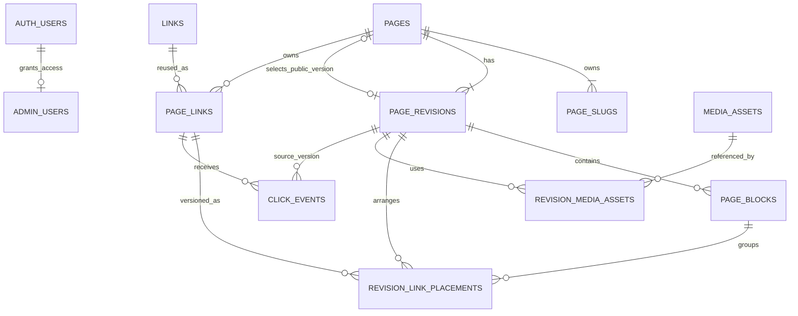

# Phân tích và thiết kế database Gờ

Ngày lập: 06/11/2026.  
Nền tảng: PostgreSQL trên Supabase.  
Trạng thái: Thiết kế logic và đề xuất thiết kế vật lý; chưa tạo database hoặc chạy migration.

Tài liệu liên quan:

- [Phân tích yêu cầu](./phan-tich-yeu-cau.md).
- [Quy định công nghệ và kiến trúc](./quy-dinh-cong-nghe-va-kien-truc.md).

## 1. Phạm vi và quyết định nền tảng

Database phục vụ một tổ chức quản lý nhiều trang thông tin trên cùng website. Không tạo database/schema riêng cho từng trang. Chưa cần `organizations`, `tenants`, gói thuê bao hoặc phân quyền theo từng khách hàng.

Thiết kế phải bảo đảm:

1. Một trang có ID ổn định dù đổi đường dẫn.
2. Link được tái sử dụng, nhưng click phân biệt được trang và vị trí nguồn.
3. Lưu nháp không đổi bản công khai; xuất bản toàn bộ nội dung trong một transaction.
4. Đổi slug, gỡ link và ẩn trang không làm mất báo cáo lịch sử.
5. Người ngoài không đọc được draft, danh mục nội bộ hoặc báo cáo qua Data API.
6. Có thể thêm trang qua quản trị mà không thay đổi schema hoặc deploy lại.

Đề xuất **10 bảng nghiệp vụ cốt lõi**, cộng một bảng phụ quản lý tham chiếu media và một bảng cấu hình slug hệ thống. Supabase quản lý riêng `auth.users` và `storage.objects`; không tự thay thế các bảng hệ thống này.

Các giả định kế thừa kiến trúc: có nháp/xuất bản; URL link gốc cập nhật tập trung ngay; nhãn/ảnh được chốt khi xuất bản. Đây là giả định thiết kế, chưa phải xác nhận bổ sung của khách hàng.

## 2. Phân nhóm dữ liệu và quan hệ

- **Truy cập:** `admin_users` xác định người được quản trị, ngoài tài khoản Auth.
- **Trang và địa chỉ:** `pages`, `page_slugs`.
- **Nội dung theo phiên bản:** `page_revisions`, `page_blocks`.
- **Danh mục và vị trí liên kết:** `links`, `page_links`, `revision_link_placements`.
- **Tài nguyên:** `media_assets`, bảng phụ `revision_media_assets`.
- **Thống kê:** `click_events`.
- **Cấu hình kỹ thuật:** bảng phụ `reserved_slugs`.

Sơ đồ diễn tả quan hệ nghiệp vụ, không thay thế toàn bộ foreign key. Quan hệ “chọn bản công khai” là con trỏ tùy chọn, độc lập với quan hệ “trang sở hữu nhiều revision”.

## 3. Quy ước dữ liệu chung

- ID nghiệp vụ: `uuid`, sinh phía database bằng `gen_random_uuid()`, trừ event ID được server sinh trước khi ghi để retry.
- Thời gian: `timestamptz`, lưu thời điểm tuyệt đối; session và API dùng UTC. Múi giờ báo cáo mặc định `Asia/Ho_Chi_Minh`.
- `created_at` mặc định `now()`; `updated_at` cập nhật bằng trigger, không tin timestamp từ trình duyệt.
- Trường văn bản bắt buộc phải kiểm tra sau `trim`; `NOT NULL` không tự cấm chuỗi rỗng.
- Dùng `text + CHECK` cho tập trạng thái nhỏ để dễ thay đổi qua migration. Không chấp nhận giá trị tự do ngoài tập cho phép.
- `position integer >= 0`; thứ tự tăng dần, không bắt buộc liên tiếp từ 0.
- JSONB dành cho theme và nội dung khối có schema; quan hệ đến link/media phải có FK hoặc bảng tham chiếu, không chỉ giấu UUID trong JSON.
- Cột tác giả như `created_by` tham chiếu `auth.users(id)` và có thể nullable khi tài khoản bị xóa bằng `ON DELETE SET NULL`. Việc xóa người dùng không xóa nội dung.
- `archived_at` là xóa mềm. Dữ liệu chưa từng công khai có thể được dọn qua quy trình riêng; không cấp thao tác xóa hàng loạt từ giao diện thường.

## 4. Từ điển dữ liệu

Trong mô tả dưới đây, PK là khóa chính, FK là khóa ngoại. Trường ghi “tùy chọn” cho phép NULL; các trường khác mặc định bắt buộc, trừ khi có ghi chú riêng.

### 4.1. `admin_users` — quyền quản trị

- `user_id uuid`: PK, FK → `auth.users.id`, `ON DELETE CASCADE`.
- `display_name text`: tên quản trị, tùy chọn.
- `is_active boolean`: mặc định `true`.
- `created_at timestamptz`.
- `updated_at timestamptz`.

Không lưu email/mật khẩu trùng với Auth. Bản đầu mọi quản trị hoạt động có cùng quyền nội dung; chưa thêm vai trò editor/viewer. Cấp và thu hồi quyền bằng quy trình vận hành tin cậy, không cho admin nội dung tự thêm mình hoặc người khác vào bảng này qua Data API. Đăng nhập thành công nhưng không có hàng hoạt động thì vẫn bị từ chối.

### 4.2. `pages` — định danh và trạng thái trang

- `id uuid`: PK.
- `internal_name text`: tên dùng trong quản trị.
- `status text`: `unpublished`, `published`, `archived`; mặc định `unpublished`.
- `published_revision_id uuid`: tùy chọn, trỏ đến revision hiện được chọn làm bản công khai.
- `lock_version bigint`: mặc định 1, tăng sau mỗi thay đổi nghiệp vụ trên trang.
- `created_by uuid`: FK tác giả, tùy chọn.
- `created_at`, `updated_at timestamptz`.
- `archived_at timestamptz`: tùy chọn.

Điều kiện công khai là đồng thời `status = 'published'`, `archived_at IS NULL` và có con trỏ revision hợp lệ. Khi ngừng xuất bản, đổi status nhưng có thể giữ con trỏ để tham khảo/khôi phục. `archived` phải tương ứng với `archived_at IS NOT NULL`; các trạng thái khác không có `archived_at`.

Không lưu thêm `slug` ở đây để tránh hai nguồn sự thật. Nội dung hiển thị, SEO và theme nằm trong revision.

### 4.3. `page_slugs` — slug hiện tại và alias

- `slug text`: PK, tối đa 80 ký tự theo giới hạn đề xuất.
- `page_id uuid`: FK → `pages.id`, `ON DELETE RESTRICT`.
- `is_current boolean`: xác định slug hiện tại.
- `created_at timestamptz`.

Ràng buộc:

- Chữ thường, không dấu, không khoảng trắng; mẫu `^[a-z0-9]+(-[a-z0-9]+)*$`.
- PK trên `slug` ngăn trùng giữa slug hiện tại và alias của mọi trang.
- Partial unique index trên `page_id WHERE is_current` bảo đảm tối đa một slug hiện tại.
- RPC tạo/đổi trang và deferred constraint trigger bảo đảm mỗi trang tồn tại có đúng một slug hiện tại khi commit. Unique index đơn lẻ chỉ bảo đảm “tối đa một”.
- Kiểm tra bảng `reserved_slugs` khi thêm/đổi; bảng cấu hình chỉ migration được sửa. Migration bổ sung tuyến mới phải phát hiện slug đang bị sử dụng trước khi dành riêng tên đó.
- Giữ alias của trang đã archive; không tự tái cấp cho trang khác, tránh link/QR cũ dẫn nhầm.

Không thêm `redirect_to_slug`: alias trỏ đến page ID rồi tìm slug hiện tại, tránh chuỗi chuyển hướng. Đổi về alias cũ của chính trang là hợp lệ; chiếm alias của trang khác là lỗi.

### 4.4. `page_revisions` — phiên bản nội dung

- `id uuid`: PK.
- `page_id uuid`: FK → `pages.id`, `ON DELETE RESTRICT`.
- `revision_no integer`: số phiên bản dương, tăng trong phạm vi trang.
- `state text`: `draft` hoặc `sealed`; mặc định `draft`.
- `lock_version bigint`: mặc định 1, dùng optimistic concurrency cho thao tác biên tập.
- `title text`: tên hiển thị.
- `description text`: mô tả trang, tùy chọn.
- `seo jsonb`: metadata có schema, mặc định `{}`; ảnh tham chiếu qua danh sách media.
- `theme jsonb`: màu, font, cỡ chữ và bố cục có schema, mặc định `{}`.
- `schema_version integer`: phiên bản schema payload, mặc định 1.
- `sealed_at timestamptz`: tùy chọn, bắt buộc khi `state = 'sealed'`.
- `created_by uuid`: FK tác giả, tùy chọn.
- `created_at`, `updated_at timestamptz`.

Unique `(page_id, revision_no)` và unique `(page_id, id)` để phục vụ FK ghép. Partial unique trên `page_id WHERE state = 'draft'` cho phép mỗi trang tối đa một bản nháp đang sửa.

`sealed` có nghĩa nội dung đã được đóng băng, không đồng nghĩa đang công khai. Bản công khai duy nhất được xác định bởi `pages.published_revision_id`; các bản từng xuất bản vẫn sealed. Tránh cập nhật trạng thái nhiều revision mỗi lần thay bản công khai.

Không sửa/xóa revision sealed hoặc các block/placement/tham chiếu media của nó bằng luồng thông thường. Trigger chặn sửa và RPC kiểm soát vòng đời. Mọi thay đổi nội dung con của draft phải khóa revision, tăng `lock_version` và kiểm tra expected version.

### 4.5. `page_blocks` — khối nội dung theo revision

- `id uuid`: PK; ID mới khi clone sang revision khác.
- `page_id uuid`: phạm vi trang, dùng cho FK ghép.
- `revision_id uuid`: revision sở hữu.
- `type text`: `profile`, `image`, `heading`, `text`, `link_list`, `social_links`, `spacer`, `divider` theo bộ khối được duyệt.
- `position integer`: thứ tự trong revision.
- `is_visible boolean`: mặc định `true`.
- `payload jsonb`: dữ liệu theo loại khối, mặc định `{}`.
- `created_at`, `updated_at timestamptz`.

FK `(page_id, revision_id)` → `page_revisions(page_id, id)`. Unique `(revision_id, position)` dạng `DEFERRABLE INITIALLY DEFERRED` cho phép đổi chỗ trong một transaction. Thêm unique `(page_id, revision_id, id)` phục vụ FK từ placement.

Zod kiểm tra schema đầy đủ ở ứng dụng; database kiểm tra JSON là object, loại khối hợp lệ và các bất biến quan hệ khi xuất bản. `schema_version` quyết định cách đọc payload cũ; nâng schema không được âm thầm sửa bản sealed.

### 4.6. `links` — danh mục link dùng chung

- `id uuid`: PK.
- `default_label text`: nhãn mặc định.
- `target_url text`: đích đã chuẩn hóa và kiểm tra.
- `kind text`: `http`, `tel`, `mailto`; bản đầu chỉ bật các loại được duyệt.
- `description text`: mô tả nội bộ, tùy chọn.
- `default_media_id uuid`: FK → `media_assets.id`, tùy chọn.
- `is_active boolean`: mặc định `true`.
- `lock_version bigint`: mặc định 1.
- `created_by uuid`: FK tác giả, tùy chọn.
- `created_at`, `updated_at timestamptz`.
- `archived_at timestamptz`: tùy chọn; archive đồng thời đặt inactive.

Không unique URL: hai mục có cùng URL có thể đại diện hai chiến dịch khác nhau. Kiểm tra protocol phù hợp với `kind` ở DB ở mức cơ bản và dùng URL parser ở server; không coi một regex là bộ xác minh URL hoàn chỉnh.

Đổi URL không đổi ID và báo cáo được cộng chung trước/sau thay đổi. Nếu cần phân biệt chiến dịch, tạo link mới. Chưa lưu bản sao URL vào từng click hoặc bảng lịch sử URL; nếu khách cần kiểm toán đích tại thời điểm bấm, phải bổ sung mô hình phiên bản đích.

### 4.7. `page_links` — vị trí link có định danh ổn định

- `id uuid`: PK, dùng trên URL `/r/{id}`.
- `page_id uuid`: FK → `pages.id`, `ON DELETE RESTRICT`.
- `link_id uuid`: FK → `links.id`, `ON DELETE RESTRICT`.
- `created_at timestamptz`.
- `archived_at timestamptz`: tùy chọn.

Unique `(page_id, id)` và `(page_id, id, link_id)` phục vụ FK ghép. Không unique `(page_id, link_id)` vì cùng link có thể xuất hiện ở hai vị trí khác nhau. Mỗi vị trí có ID riêng.

`page_id`, `link_id` bất biến sau khi tạo. Đổi vị trí sang link gốc khác phải tạo `page_links` mới; nếu tái sử dụng ID cũ, báo cáo sẽ gán nhầm lịch sử.

Gỡ link trong draft chỉ xóa placement của draft; **không archive `page_links` ngay**, vì vị trí có thể vẫn nằm trong bản công khai. Không tự archive vị trí chỉ vì nó vắng mặt ở revision mới; việc nó còn hiệu lực được xác định bằng membership trong revision công khai. Archive vị trí chỉ dùng cho thao tác vô hiệu hóa có chủ đích và không được làm mất lịch sử.

### 4.8. `revision_link_placements` — vị trí link trong một phiên bản

- `id uuid`: PK, ID mới khi clone revision.
- `page_id uuid`, `revision_id uuid`, `block_id uuid`: phạm vi trang/revision/khối chứa.
- `page_link_id uuid`: vị trí ổn định được sử dụng.
- `position integer`: thứ tự trong khối.
- `label_override text`: nhãn biên tập, tùy chọn.
- `media_override_id uuid`: FK → `media_assets.id`, tùy chọn.
- `resolved_label text`: nhãn đã chốt khi publish, NULL khi chưa resolve ở draft.
- `resolved_media_id uuid`: FK → `media_assets.id`, tùy chọn; NULL cũng có thể nghĩa là không dùng ảnh.
- `created_at`, `updated_at timestamptz`.

FK ghép `(page_id, revision_id, block_id)` → `page_blocks(page_id, revision_id, id)`; FK `(page_id, page_link_id)` → `page_links(page_id, id)`.

Unique `(revision_id, page_link_id)` bảo đảm một vị trí ổn định chỉ xuất hiện một lần trong cùng revision. Unique `(block_id, position)` dùng constraint deferred để sắp xếp lại an toàn. RPC xuất bản kiểm tra khối chứa có loại `link_list` hoặc `social_links`, và resolved label không rỗng.

Khi publish, resolve nhãn/ảnh từ override hoặc mặc định trong `links` rồi lưu vào bản sealed. Render công khai chỉ dùng giá trị resolved; không fallback sang nhãn/ảnh hiện tại của danh mục. URL vẫn đọc trực tiếp từ `links` theo quy tắc cập nhật tập trung.

### 4.9. `media_assets` — tài nguyên trong Storage

- `id uuid`: PK.
- `bucket_id text`, `object_path text`: định danh object; unique cặp này.
- `visibility text`: `private` hoặc `public`.
- `status text`: `pending`, `ready`, `failed`, `deleting`.
- `mime_type text`, `size_bytes bigint`: metadata được server xác minh, có thể NULL lúc pending.
- `width integer`, `height integer`: tùy chọn khi chưa xác minh.
- `original_filename text`: tên gốc cho quản trị, tùy chọn.
- `created_by uuid`: FK tác giả, tùy chọn.
- `created_at timestamptz`.
- `archived_at timestamptz`: tùy chọn.

Không lưu binary/base64 và signed URL vào database. Không tạo FK tùy tiện vào cấu trúc nội bộ của `storage.objects`; kiểm tra sự tồn tại qua Storage API và tác vụ đối soát.

Object public phải bất biến theo đường dẫn: thay ảnh thì tạo asset/object mới. Không overwrite object mà revision sealed đang tham chiếu. FK đến asset mặc định `RESTRICT` để không xóa metadata còn dùng.

### 4.10. `click_events` — sự kiện click

- `id uuid`: PK, event ID server sinh và giữ nguyên khi retry cùng một lần ghi.
- `page_id uuid`, `link_id uuid`, `page_link_id uuid`, `revision_id uuid`: nguồn đã được server xác minh.
- `occurred_at timestamptz`: mặc định thời gian database nhận; không nhận thời gian tùy ý từ browser.

FK `(page_id, revision_id)` → `page_revisions(page_id, id)`; FK `(page_id, page_link_id, link_id)` → `page_links(page_id, id, link_id)`.

Bảng append-only đối với runtime: không cho client sửa/xóa event. Mặc định không lưu IP, user-agent đầy đủ, referrer URL, fingerprint hoặc mã khách truy cập. Đây là tổng click, không phải số người duy nhất. Không cần status xử lý vì bản đầu ghi trực tiếp, chưa có hàng đợi.

Event phải có placement trong revision nguồn, khối và placement có thể hiển thị, trang công khai và link hoạt động tại thời điểm xác minh. Điều kiện động này kiểm tra bằng RPC; FK chỉ bảo đảm danh tính và quan hệ lâu dài.

### 4.11. Bảng phụ

**`revision_media_assets`:** `revision_id uuid`, `media_asset_id uuid`, PK ghép hai cột, FK → revision và asset, mặc định `RESTRICT`. Đây là tập tham chiếu chuẩn của tất cả ảnh dùng trong theme, SEO, payload khối và resolved placement. RPC lưu draft đồng bộ tập này từ payload; RPC publish xây lại và xác minh không thiếu tham chiếu. Không tin danh sách UUID do client tự khai.

Tham chiếu media của revision sealed cũng bất biến. Bảng giúp ngăn dọn nhầm ảnh và kiểm tra mọi asset công khai đã ready/public. Ảnh mặc định của link có FK trực tiếp, không cần đưa vào tập revision cho đến khi được resolve.

**`reserved_slugs`:** `slug text` PK, `reason text`. Seed các tuyến hệ thống gồm `admin`, `api`, `auth`, `login`, `r`, `assets` và các tuyến tĩnh thực tế khác. Chỉ migration/vận hành được thay đổi; danh sách trong ứng dụng phải đồng bộ.

`audit_logs`, `link_versions`, `daily_click_stats`, `page_views` chưa nằm trong bộ bảng bắt buộc. Chỉ thêm khi phạm vi hoặc tải thực tế cần đến.

## 5. Các bất biến cần database bảo vệ

### 5.1. Con trỏ bản công khai cùng trang

FK `(pages.id, pages.published_revision_id)` → `page_revisions(page_id, id)` ngăn chọn revision của trang khác. FK được thêm sau khi tạo hai bảng để xử lý quan hệ vòng.

FK không xác minh được revision có sealed hay không. Dùng RPC xuất bản và constraint trigger kiểm tra khi thay con trỏ; không dùng `CHECK` truy vấn bảng khác. Khi sửa block/placement, trigger và khóa revision phải bảo đảm revision chưa sealed.

### 5.2. Tính nhất quán khi biên tập

Mọi RPC sửa trang phải khóa theo thứ tự chung: hàng `pages` → revision liên quan → các link theo ID nếu cần → các hàng con. Không có đường ghi khác bỏ qua khóa rồi seal đồng thời. Việc clone/lưu lại cả bản nháp phải nằm trong cùng transaction.

Client gửi expected version; server so sánh sau khi khóa. Không khớp thì trả lỗi conflict và không ghi một phần. Reorder dùng deferred unique constraints hoặc cập nhật trong transaction có thứ tự được thiết kế; không tắt unique để tránh lỗi.

### 5.3. Nhất quán dữ liệu lịch sử

Không đổi cặp trang/link của một `page_links`. Không sửa revision sealed để đổi nhãn/ảnh cũ. Không cascade xóa từ trang/link/revision sang event. Dùng ID để nhóm báo cáo; tên hiện tại chỉ phục vụ hiển thị, phải phân biệt nếu báo cáo muốn nhãn tại thời điểm xuất bản.

Các nguyên tắc về FK, CHECK và constraint hoãn kiểm tra dựa trên [tài liệu PostgreSQL về constraints](https://www.postgresql.org/docs/current/ddl-constraints.html). Khóa và thứ tự khóa cần được kiểm chứng bằng kiểm thử đồng thời theo [tài liệu explicit locking](https://www.postgresql.org/docs/current/explicit-locking.html).

## 6. Ranh giới truy cập và RLS

### 6.1. Phương án đề xuất

Đặt bảng nghiệp vụ trong schema `public`, bật RLS trên tất cả bảng và thu hồi quyền mặc định không cần thiết. Bản đầu **không cấp `anon` quyền SELECT bảng gốc**. Trang công khai đọc qua RPC `get_public_page(slug)` trả DTO giới hạn; đây là cách cụ thể hóa lựa chọn public RPC trong tài liệu kiến trúc.

- `anon`: chỉ EXECUTE RPC đọc trang công khai; không liệt kê danh mục trang, link hoặc metadata ảnh nháp.
- `authenticated` chưa có quyền quản trị: có thể đọc cùng RPC công khai; không đọc bảng nghiệp vụ hoặc dùng RPC quản trị.
- Quản trị hoạt động: SELECT dữ liệu quản trị qua RLS; đọc danh sách quyền chỉ cần hàng của chính mình. Thay đổi nghiệp vụ đi qua RPC được giới hạn.
- Runtime tin cậy của Next.js: dùng secret client cho RPC resolve/ghi click; không dùng làm client mặc định của quản trị.
- Vai trò migration/vận hành: quản lý schema, cấp quản trị và tác vụ dọn dữ liệu; credential tách khỏi runtime.

Không cấp trực tiếp INSERT/UPDATE/DELETE bảng nội dung cho vai trò trình duyệt. RPC ghi cần `SECURITY DEFINER` trong thiết kế này để thực thi transaction dù người gọi không có DML trực tiếp. Đây là ngoại lệ có chủ đích so với mặc định invoker: mỗi RPC quản trị phải tự kiểm tra `auth.uid()` thuộc `admin_users` hoạt động, không nhận `user_id` từ client để thay xác thực.

RLS vẫn bảo vệ SELECT của quản trị và các quyền bảng vô tình được mở thêm. Do function definer có thể vượt RLS, kiểm tra trong function là ranh giới bắt buộc, không được giả định policy sẽ tự chặn.

### 6.2. Function hỗ trợ quyền

Đặt helper `private.is_active_admin()` trong schema không expose qua Data API. Function chỉ trả boolean cho `auth.uid()` hiện tại, đọc bảng quản trị bằng quyền được giới hạn và không gọi ngược policy của chính bảng đó gây đệ quy.

Với function definer:

- Cố định `search_path` an toàn, ưu tiên rỗng và định danh đầy đủ schema khi truy vấn.
- Revoke EXECUTE mặc định từ `PUBLIC` trong cùng migration rồi grant đúng vai trò.
- Không nhận SQL, tên bảng hoặc biểu thức lọc tùy ý để thực thi động.
- Chỉ trả cột đã được phép; không `SELECT *` rồi chuyển nguyên hàng thành JSON.
- RPC đọc công khai kiểm tra trạng thái trang và revision trong chính câu truy vấn, không chỉ kiểm tra slug tồn tại.
- RPC dành cho service chỉ cấp `service_role` theo cơ chế key server của Supabase; không cấp `anon` quyền tự chèn event.

Tham khảo [RLS của Supabase](https://supabase.com/docs/guides/database/postgres/row-level-security) và [quyền thực thi database functions](https://supabase.com/docs/guides/database/functions).

### 6.3. Chính sách Storage

- Bucket private: quản trị hoạt động mới upload/đọc; signed URL chỉ cấp sau kiểm tra quyền.
- Bucket public: chỉ ảnh đã được chọn công khai; người ngoài đọc được object URL, quyền ghi/xóa vẫn giới hạn.
- Không dùng tên file gốc làm object path; dùng UUID/path không trùng, không cho overwrite asset đang tham chiếu.
- Quyền `storage.objects` phải kiểm tra bucket/path và quyền admin thực tế, không chỉ kiểm tra có phiên Auth.
- Dọn ảnh phải kiểm tra cả FK từ link, override và tập `revision_media_assets`, gồm draft lẫn sealed. Không xóa object chỉ vì trang vừa ngừng xuất bản.

## 7. Danh sách RPC và hợp đồng xử lý

### 7.1. Các thao tác quản trị

- `create_page(internal_name, slug)`: tạo page, slug hiện tại và draft đầu tiên trong một transaction.
- `save_page_draft(page_id, revision_id, expected_version, document)`: kiểm tra quyền, khóa trang/revision, kiểm tra schema và quan hệ, đồng bộ block/placement/media, tăng version; trả version mới.
- `publish_page(page_id, draft_id, expected_page_version, expected_draft_version)`: seal draft và thay con trỏ công khai đồng thời.
- `unpublish_page(page_id, expected_page_version)`: khóa trang, đổi status, giữ nội dung và lịch sử.
- `rename_page_slug(page_id, new_slug, expected_page_version)`: đổi slug hiện tại, giữ alias cũ; unique constraint giải quyết tranh chấp giữa hai trang.
- `duplicate_page(source_page_id, new_slug)`: tạo trang/draft mới, clone nội dung; map block và page-link sang ID mới. Giữ chung link gốc và media bất biến, không clone click hoặc alias.
- `upsert_link(...)`, `deactivate_link(...)`: kiểm tra quyền, URL và expected version; trả số trang bị ảnh hưởng khi sửa đích.
- `archive_page(...)`: ngừng công khai, giữ registry và lịch sử.
- `get_click_report(from, to, page_id?, link_id?, timezone)`: chỉ quản trị, trả tổng và các nhóm cần hiển thị; giới hạn khoảng ngày và kích thước kết quả.

Tên/chữ ký là hợp đồng dự kiến, sẽ chốt khi viết migration. Mọi RPC có đầu vào array/JSON phải giới hạn số khối, số link và kích thước payload; hạn mức là cấu hình vận hành, không nhận số lượng không giới hạn.

### 7.2. Transaction xuất bản

1. Xác minh quản trị hoạt động; khóa hàng trang rồi draft, đối chiếu cả hai expected version.
2. Kiểm tra trang chưa archive, draft đúng trang và `state = 'draft'`.
3. Kiểm tra slug hiện tại, payload, thứ tự, loại block chứa link và FK nghiệp vụ. Trang không có link vẫn có thể hợp lệ nếu bộ khối cho phép.
4. Đọc/khóa chia sẻ các link liên quan theo thứ tự ID để tránh thay mặc định giữa bước resolve. Chỉ đưa các vị trí đủ điều kiện hiển thị vào DTO công khai.
5. Resolve nhãn/ảnh; xây lại tập media, kiểm tra tất cả asset cần công khai ở trạng thái ready/public.
6. Đổi revision thành sealed, ghi `sealed_at`, cập nhật con trỏ và `status = 'published'`, tăng version của trang.
7. Commit; nếu bất kỳ bước nào lỗi thì rollback toàn bộ.

Không thực hiện copy ảnh qua mạng trong transaction SQL. Chuẩn bị bản ảnh public trước, sau đó publish bằng tham chiếu đã ready. Nếu transaction thất bại, object public chưa tham chiếu có thể còn lại và được tác vụ dọn sau thời gian chờ xử lý; không giả định DB và Storage có cùng transaction.

Sau publish, chỉ tạo draft tiếp khi người dùng bắt đầu sửa: clone từ revision được chọn, cấp block/placement ID mới nhưng giữ `page_link_id` cho cùng vị trí. Draft được tạo bằng RPC có khóa để không sinh hai draft song song.

Ảnh copy sang public trước commit có thể truy cập được nếu biết URL ngay cả khi trang chưa publish. Nếu yêu cầu bảo mật cả thời điểm công bố ảnh, phải dùng private storage và cổng cấp quyền truy cập phù hợp; không thể coi tên object ngẫu nhiên là cơ chế phân quyền.

### 7.3. Đọc công khai

`get_public_page(slug)` chạy bằng definer giới hạn, cấp EXECUTE cho `anon` và `authenticated`:

1. Tra slug và trang, lọc status/archived/con trỏ sealed hợp lệ.
2. Với alias, trả canonical slug để ứng dụng chuyển hướng; không trả nội dung trang ẩn.
3. Trả title, description, theme/SEO đã lọc, block visible, link placements có link hoạt động và asset public/ready được phép.
4. Không trả author ID, draft ID, danh mục link chưa gắn, tên nội bộ, thông tin quyền hoặc thống kê.

Đọc bằng một truy vấn/statement snapshot nhất quán để không ghép nửa phiên bản cũ và nửa phiên bản mới giữa các lần gọi. Preview dùng RPC/query có quyền admin, không thêm tham số `include_draft=true` vào RPC công khai.

### 7.4. Resolve và ghi click

Chia hai bước để lỗi ghi event không làm hỏng việc mở đích đã xác định:

1. `resolve_public_link(page_link_id)`, chỉ server tin cậy được gọi: xác minh trang đang công khai, con trỏ revision, membership, block visible, vị trí chưa archive và link hoạt động; trả tuple nguồn cùng URL đã quản lý.
2. Server sinh event ID, gọi `record_click(event_id, page_link_id, expected_revision_id)` với thời hạn giới hạn. Function tự suy ra page/link ID, xác minh lại nguồn và chèn event, không tin bộ ID do trình duyệt gửi.
3. Server chuyển hướng tới đích đã resolve kể cả bước ghi bị lỗi; log lỗi và chấp nhận mất event theo quy định kiến trúc.

Nếu trang bị ẩn hoặc xuất bản lại giữa hai bước, bước ghi có thể từ chối event vì expected revision không còn hiện hành. Request đã resolve vẫn có thể mở đích cũ; đây là giới hạn đồng thời được chấp nhận cho bản đầu, không cam kết thu hồi tức thời request đang chạy.

Retry cùng event ID trả kết quả idempotent nếu nguồn trùng event đã lưu; nếu ID trùng nhưng nguồn khác thì báo lỗi, không bỏ qua im lặng. Retry một event đã lưu không phụ thuộc việc trang sau đó bị ẩn. `ON CONFLICT DO NOTHING` đơn lẻ chưa đủ xác minh điều này.

Không ghi cho `HEAD`, preview hoặc bot đã nhận biết tại server. Không gọi endpoint click từ bộ prefetch. `tel`/`mailto` đi qua luồng ghi nhận riêng nếu được triển khai; nguồn vẫn xác minh như HTTP. Không có quyền ghi click trực tiếp từ publishable key.

## 8. Index, truy vấn và khả năng mở rộng

### 8.1. Index ban đầu

Ngoài index từ PK/unique và partial unique đã nêu, dự kiến:

- `page_slugs(page_id)`: tìm alias và xác định slug hiện tại.
- `page_revisions(page_id, revision_no DESC)`: danh sách phiên bản.
- `page_blocks(revision_id, position)`: đã được unique hỗ trợ, không tạo bản trùng.
- `page_links(link_id, page_id)`: tìm trang đang tham chiếu link và đánh giá ảnh hưởng.
- `revision_link_placements(page_link_id)`: kiểm tra nguồn và tham chiếu; index theo revision cần đối chiếu với unique hiện có.
- `revision_media_assets(media_asset_id)`: kiểm tra ảnh còn được dùng trước khi dọn.
- `click_events(page_id, occurred_at)`: thống kê theo trang và thời gian.
- `click_events(link_id, occurred_at)`: phân rã theo link.
- `click_events(occurred_at)`: báo cáo toàn hệ thống theo thời gian và tác vụ retention.

PostgreSQL không tự tạo index trên mọi cột FK phía con. Khi viết migration cần rà soát cả FK media, revision, placement để thêm index phục vụ kiểm tra/xóa hoặc truy vấn thực tế; không tạo tất cả tổ hợp một cách máy móc.

### 8.2. Quy tắc báo cáo

- Mỗi event hợp lệ đóng góp 1; không lưu thêm bộ đếm trong `links`/`pages` ở bản đầu để tránh hai nguồn thống kê.
- Lọc `occurred_at >= from_utc AND occurred_at < to_utc`, rồi group theo ID. Group ngày theo múi giờ hiển thị, không lấy ngày UTC rồi gắn nhãn Việt Nam.
- Ví dụ ngày 06/11/2026 ở Việt Nam tương ứng khoảng UTC từ `2026-11-05T17:00:00Z` đến trước `2026-11-06T17:00:00Z`.
- Khi hiển thị tên từ dữ liệu hiện tại, phải LEFT JOIN cả thực thể đã archive; không lọc `is_active` làm mất lịch sử báo cáo.
- Các tổng và phân rã của cùng một màn hình nên dùng một RPC/snapshot; nếu truy vấn riêng trong lúc có event mới, tổng có thể lệch tạm thời.
- Danh sách event nếu có dùng keyset pagination theo `(occurred_at, id)`; không trả hàng triệu event cho trình duyệt.

### 8.3. Ước lượng dung lượng và ngưỡng nâng cấp

Chưa có số truy cập thực tế, vì vậy không thể chốt gói Supabase hoặc dung lượng chính xác. Với `C` click/ngày và giữ `D` ngày: số hàng dự kiến là `C × D`. Ví dụ giả định 10.000 click/ngày, giữ 365 ngày tạo 3.650.000 hàng; đây là kịch bản tính toán, không phải dự báo lưu lượng dự án.

Đo kích thước bảng và index bằng dữ liệu giả có cùng schema; ước lượng từ byte/hàng thực tế cộng headroom cho index, bloat và tăng trưởng. Dùng EXPLAIN trên staging cho truy vấn báo cáo.

Chỉ thêm bảng tổng hợp ngày khi độ trễ truy vấn thực đo vượt mục tiêu đã chốt. Chỉ partition khi retention/tải ghi cần đến; lưu ý unique toàn cục event ID cần thiết kế lại nếu partition theo thời gian. Chưa thêm queue/Redis chỉ vì có thống kê click.

## 9. Vòng đời dữ liệu và phục hồi

- Trang/link archive giữ ID, alias và event. Ẩn trang ngăn đọc mới nhưng không thu hồi nội dung đã tải hoặc URL ảnh public.
- Không xóa revision sealed còn được click hoặc bản công khai tham chiếu. Có thể dọn draft bỏ dở bằng job có kiểm tra trạng thái và thời gian chờ.
- Dọn asset là quy trình hai bước: đánh dấu deleting khi không còn tham chiếu, xóa Storage bằng API, rồi hoàn tất metadata; retry an toàn và đối soát object mồ côi. Quy trình gắn media mới phải từ chối asset deleting và phối hợp khóa để tránh attach trong lúc dọn.
- Click retention phải chốt trước production. Nếu xóa event cũ mà không lưu tổng hợp, báo cáo ngoài thời hạn đó sẽ không còn đầy đủ; không hiển thị như lịch sử trọn đời.
- Sao lưu database và Storage là hai phần; kiểm tra khôi phục cùng tham chiếu object, không chỉ kiểm tra SQL restore thành công.
- Không xóa/sửa trực tiếp dữ liệu sản xuất để chữa lỗi mà không có ghi nhận và phương án phục hồi.

## 10. Thứ tự migration dự kiến

1. Helper quyền, `admin_users`, `reserved_slugs`; chưa cấp quyền rộng trong giai đoạn khởi tạo.
2. `media_assets`, `links`, `pages` chưa có FK con trỏ revision.
3. `page_slugs`, `page_revisions`, sau đó thêm FK con trỏ từ pages.
4. `page_blocks`, `page_links`, `revision_link_placements`, `revision_media_assets` và FK ghép.
5. `click_events`, index, trigger version và trigger bảo vệ nội dung sealed.
6. RPC quản trị, public DTO, resolve/ghi click và báo cáo; revoke/grant, RLS và policies trong cùng đợt migration an toàn.
7. Seed giả lập và bộ kiểm thử quyền/transaction trước khi cho ứng dụng kết nối.

Thực hiện trên Supabase local/staging, kiểm tra phiên bản PostgreSQL thực tế được Supabase cấp; không giả định dự án chạy đúng phiên bản mới nhất của PostgreSQL. Không chạy migration trong quá trình build Vercel. Tài khoản quản trị production được bootstrap riêng, không commit credential hoặc ID tài khoản thật vào seed.

## 11. Tình huống kiểm chứng thiết kế

1. Tạo trang A và B; cùng link X nhưng hai `page_links` khác nhau; ghi 12 và 5 event, báo cáo trả A=12, B=5, X=17.
2. Sửa draft A, bỏ X; trang công khai A vẫn hiển thị và ghi click cho X trước khi publish.
3. Publish draft A đã bỏ X; URL vị trí cũ không tạo event mới như vị trí hiện hành, 12 event cũ vẫn còn.
4. Đổi slug A hai lần; alias đều trỏ thẳng đến slug hiện tại, lịch sử vẫn thuộc ID A.
5. Đổi về alias của chính A thành công; chiếm slug/alias của B thất bại, kể cả request đồng thời.
6. Hai người lưu cùng version draft: chỉ một thao tác thành công, thao tác sau nhận conflict.
7. Cố gắn block/revision/page-link của A vào B: FK ghép hoặc kiểm tra transaction từ chối.
8. Cố sửa block của revision sealed qua Data API hoặc RPC quản trị: bị từ chối.
9. Người có Auth nhưng không có admin hoạt động không đọc/sửa draft, gọi publish hoặc xem báo cáo; quản trị bị thu hồi quyền cũng bị chặn dù token chưa hết hạn.
10. Thử gọi RPC ghi click bằng publishable key: bị từ chối. Retry cùng event ID không tăng tổng; ID trùng nhưng nguồn khác bị báo lỗi.
11. Lỗi ở bước cuối publish: con trỏ vẫn ở bản cũ, draft không sealed nửa chừng.
12. DB đọc được URL nhưng ghi event lỗi: ứng dụng vẫn chuyển hướng, log lỗi; mô phỏng race ẩn/xuất bản giữa resolve và record.
13. Đổi default label/ảnh không làm thay revision sealed; đổi URL có hiệu lực tập trung đúng giả định.
14. Không xóa/overwrite được ảnh đang được revision tham chiếu; upload/copy dở không thể publish như asset ready.
15. Event ở đúng biên `17:00 UTC` được tính đúng ngày Việt Nam; tổng/phân rã cùng snapshot khớp nhau.
16. Archive trang hoặc link không mất báo cáo; người ngoài không đọc được trang ẩn bằng slug hiện tại, alias hoặc ID revision cũ.

Đây là tiêu chí để xây kiểm thử khi triển khai, chưa phải kết quả đã chạy trên database.

## 12. Các quyết định còn cần xác nhận

Thiết kế có thể chuyển sang SQL migration sau khi xác nhận các giả định ảnh hưởng trực tiếp dữ liệu:

1. Có dùng nháp/xuất bản độc lập đúng như đề xuất không?
2. URL gốc cập nhật ngay, còn nhãn/ảnh chốt theo revision có đúng mong muốn không?
3. Bộ khối đầu tiên và việc đo nút gọi điện/email có trong phạm vi không?
4. Thời hạn lưu click, mục tiêu độ trễ báo cáo và quy mô truy cập dự kiến?
5. Ảnh public có được chấp nhận là vẫn mở qua URL sau khi ẩn trang không?
6. Có cần lịch sử đổi URL, audit thao tác hoặc vai trò quản trị khác nhau ngay bản đầu không?

Các lựa chọn này được đánh dấu để tránh biến giả định thành yêu cầu đã chốt. Phần phân tích hiện tại chưa tạo bảng, policy hoặc migration trên Supabase.
