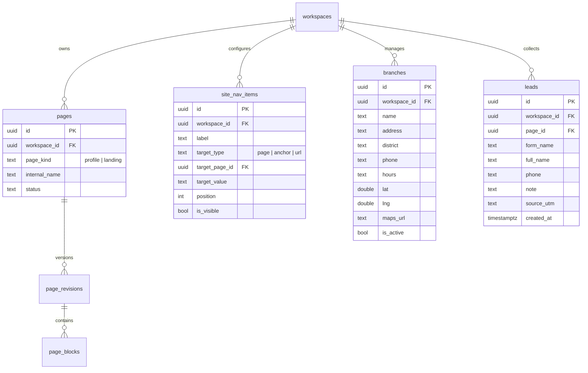

# Phân tích & Đánh giá Kiến trúc: Nâng cấp `gocafe.profile` thành Platform CMS (Profile + Landing Page)

> **Tóm tắt:** Tài liệu này đánh giá tính khả thi, thiết kế kiến trúc dữ liệu, trải nghiệm người dùng (UX) và lộ trình triển khai để nâng cấp nền tảng hiện tại thành **Platform CMS tự cấu hình** hỗ trợ tách biệt hai loại hình: **Trang Profile (Bio Link)** và **Landing Page / Mini-Website** — đáp ứng trực tiếp toàn bộ yêu cầu thực tế từ Gờ Café.

---

## 1. Đánh giá nền tảng hiện tại: Tái sử dụng được bao nhiêu?

Hệ thống `gocafe.profile` hiện tại đã có kiến trúc lõi rất vững, cho phép **tái sử dụng ~70–80% hạ tầng** mà không cần viết lại từ đầu:

| Lớp hệ thống                     | Hiện trạng đã có                                                                              | Mức độ tái sử dụng cho Landing Page CMS                                                     |
| -------------------------------- | --------------------------------------------------------------------------------------------- | ------------------------------------------------------------------------------------------- |
| **Multi-tenant & Bảo mật**       | Workspace, JWT (`getClaims`), Hierarchical RBAC (`owner/editor/viewer`), PostgreSQL RLS       | **100%** — Mỗi thương hiệu / workspace quản lý độc lập cả Profile lẫn Landing Page          |
| **Quản lý phiên bản & Xuất bản** | `page_revisions` (`draft`/`sealed`), Optimistic Locking, Auto-save 2s, Undo/Redo, Nhân bản    | **100%** — Landing Page kế thừa ngay quy trình Lưu nháp / Xuất bản an toàn                  |
| **Block Engine**                 | `BLOCK_REGISTRY` + `BLOCK_PAYLOAD_SCHEMAS` (14 khối) + `BlockFrame` (style riêng từng khối)   | **85%** — Chỉ cần mở rộng thêm nhóm khối chuyên dụng cho Landing Page (full-width)          |
| **Theme & Typography**           | Theme Tokens v2 (`src/config/theme-tokens.ts`), đã tích hợp sẵn Google Font **`Lexend Deca`** | **90%** — Bổ sung preset _Trắng – Đen – Vàng đồng_ & token độ rộng khung Desktop (`1200px`) |
| **Media & Analytics**            | Kho ảnh + Cropper (`Supabase Storage`), theo dõi lượt bấm `/r/{id}` + Báo cáo                 | **100%** — Bổ sung thêm tracking lượt gửi Form (Lead)                                       |

**Kết luận khả thi:** **Hoàn toàn khả thi** để nâng cấp trực tiếp trên codebase hiện tại mà **không làm ảnh hưởng** đến các trang Profile đang chạy ngoài thực tế.

---

## 2. Kiến trúc tách biệt `Profile` và `Landing Page`

### 2.1. Tách biệt ngay từ mô hình dữ liệu (`page_kind`)

Thêm cột `page_kind text NOT NULL DEFAULT 'profile' CHECK (page_kind IN ('profile', 'landing'))` trên bảng `pages`:

| Tiêu chí                        | Loại 1: Trang Profile (Bio Link)                                   | Loại 2: Landing Page / Mini-Website                                                                                                                                |
| ------------------------------- | ------------------------------------------------------------------ | ------------------------------------------------------------------------------------------------------------------------------------------------------------------ |
| **Mục đích**                    | Hồ sơ cá nhân/kênh, gắn bio TikTok/IG/Shopee, quét QR nhanh        | Website thương hiệu nhiều mục/tab (Trang chủ, Về chúng tôi, Hệ thống quán, Menu, Xưởng rang, Tuyển dụng, Liên hệ...)                                               |
| **Khung hiển thị mặc định**     | Dọc chuẩn Mobile (`max-w: 420–620px`), 1 cột                       | Full-width Responsive (`max-w: 1200–1280px` trên Desktop, tự co gọn trên Mobile)                                                                                   |
| **Thanh điều hướng (Navbar)**   | Không có                                                           | **Có** — Tự thêm/xoá/sắp xếp Tab trên đầu trang + Footer nhiều cột + nút Zalo/Gọi nổi góc màn hình                                                                 |
| **Bộ khối (Blocks)**            | 14 khối Profile hiện tại (Link List, Button, Header, Menu Card...) | Nhóm khối Section Landing Page (Hero Banner, Split 2 cột, Hệ thống chi nhánh + Bản đồ, Bảng sản phẩm, Form thu thập SĐT, Footer...) + dùng lại được các khối chung |
| **Trình biên tập Preview**      | Mặc định khung Điện thoại `375px`                                  | Mặc định khung **Desktop rộng** (có nút chuyển nhanh Desktop / Tablet / Mobile)                                                                                    |
| **Bộ lọc trong `/admin/pages`** | Tab lọc riêng: `Tất cả` \| `Trang Profile` \| `Landing Page`       | Quản lý chung danh sách nhưng có badge phân loại rõ ràng                                                                                                           |

### 2.2. Luồng tạo mới tách biệt (Wizard 2 bước)

Khi người dùng bấm **"Tạo trang mới"**:

1. **Bước 1 — Chọn loại hình:**
   - **Thẻ 1: Trang Profile (Bio Link)** — _"Trang liên kết gọn nhẹ tối ưu cho di động, TikTok, Facebook, mã QR."_
   - **Thẻ 2: Landing Page / Website** — _"Trang giới thiệu thương hiệu đầy đủ: thanh menu nhiều tab, banner lớn, bản đồ chi nhánh, form nhận thông tin."_
2. **Bước 2 — Chọn Mẫu dựng sẵn (Template):**
   - Người dùng xem trước các mẫu dựng sẵn (kèm cấu trúc section, màu sắc, font chữ chuẩn) và bấm **"Dùng mẫu này"** → hệ thống tự sinh toàn bộ nội dung mẫu để người quản trị chỉ việc thay chữ & ảnh, không phải dựng từng khối từ trang trắng.

---

## 3. Phân tích chi tiết 4 yêu cầu trọng tâm từ khách hàng (Gờ Café)

### 3.1. Tự thêm/sửa/sắp xếp Tab điều hướng (_"Làm sao để chị tự thêm tab, tự làm được hết càng tốt"_)

Để quản lý 8 mục (_Trang chủ, Về chúng tôi, Hệ thống quán, Menu thức uống, Cà phê rang xay, Dành cho chủ quán, Tuyển dụng, Liên hệ_), có 2 cơ chế — **khuyến nghị hỗ trợ cả hai trong cùng 1 thanh quản lý Tab (`Site Navigation`)**:

1. **Cơ chế A — Tab là các Trang con (Multi-page Site) _(Khuyên dùng cho 8 mục lớn)_:**
   - Gom các Landing Page thuộc cùng 1 website dùng chung cấu hình `navigation` của workspace.
   - Trong Admin có mục **"Menu điều hướng"** trực quan: bấm `+ Thêm tab` → nhập tên Tab (VD: _Menu thức uống_) → chọn 1 trong 3 kiểu đích:
     - **Liên kết tới 1 trang có sẵn** (VD: `/menu-thuc-uong`) hoặc bấm _"Tạo trang mới cho tab này"_ ngay tại chỗ.
     - **Cuộn tới một mục (Section Anchor)** ngay trên cùng trang (VD: `#lien-he`).
     - **Mở link ngoài** (VD: Shopee / iPOS đặt hàng).
   - Kéo thả đổi thứ tự tab, bật/tắt ẩn hiện tab tức thì.
2. **Cơ chế B — Single-page Landing Page (Tab cuộn mượt trong 1 trang):**
   - Phù hợp cho chiến dịch ngắn hạn (1 trang duy nhất, bấm tab tự cuộn mượt đến từng section).

> **Lợi ích vận hành:** Mỗi trang Landing Page kế thừa **Header (Navbar) + Footer dùng chung** của Workspace (hoặc tuỳ chọn ghi đè riêng) → chỉ cần thêm 1 tab mới ở 1 chỗ là **tất cả 8 trang con tự cập nhật thanh menu cùng lúc**.

---

### 3.2. Bộ mẫu dựng sẵn & Gu thiết kế Gờ Café

Gu thẩm mỹ yêu cầu: **Đơn giản, chữ không chân (Lexend), tông Trắng – Đen – điểm nhấn Vàng đồng**.

- **Đã có sẵn trong dự án:** `Lexend_Deca` đã được tải sẵn trong `src/app/layout.tsx` và `src/config/theme-tokens.ts`.
- **Đề xuất dựng sẵn 3 mẫu Landing Page chọn ngay:**
  1. **Gờ Minimal Luxury (Mặc định gợi ý):** Nền Trắng tinh `#FFFFFF`, chữ & nút Đen than `#111111`, điểm nhấn Vàng đồng `#B88A44`, font `Lexend Deca`, nhiều khoảng trắng sang trọng.
  2. **Dark Roastery (Xưởng rang cao cấp):** Nền Đen nhám `#101010`, chữ Trắng ngà, nhấn Vàng đồng `#C59B5F`, hợp cho trang _Cà phê rang xay_.
  3. **Warm Coffee House (Ấm áp thân thiện):** Nền Kem sáng `#FAF7F2`, nhấn Nâu cà phê `#6B4423`, hợp cho _Về chúng tôi / Menu_.

---

### 3.3. Hệ thống Bản đồ Chi nhánh tương tác 2 chiều (`store_locator`)

Yêu cầu: _"Bấm vào đâu trên bản đồ thì nhảy địa chỉ & thông tin ở đó, có thể search tên đường, quận bên danh sách"_ (tương tự `go-cafe.com/danh-sach-chi-nhanh/` với ~55 quán).

#### So sánh 3 giải pháp kỹ thuật bản đồ

| Giải pháp                                                         | Tương tác 2 chiều (Map ⇄ List)                                                                              | Search tên đường / quận                                                                  | Chi phí vận hành                                                   | Khuyến nghị                                                                 |
| ----------------------------------------------------------------- | ----------------------------------------------------------------------------------------------------------- | ---------------------------------------------------------------------------------------- | ------------------------------------------------------------------ | --------------------------------------------------------------------------- |
| **Google My Maps `<iframe>`** _(web cũ đang dùng)_                | **Không** (iframe tách biệt hoàn toàn với danh sách bên phải)                                               | Không đồng bộ được với bản đồ                                                            | Miễn phí                                                           | Không đáp ứng yêu cầu bấm nhảy 2 chiều                                      |
| **Leaflet / MapLibre + OpenStreetMap (Carto Voyager / Positron)** | **Hoàn hảo 100%** (bấm pin → cuộn & highlight quán bên phải; bấm quán → bản đồ zoom/bay tới pin + mở popup) | **Có** — lọc tức thì theo tên quán, tên đường, quận/huyện, tìm kiếm không dấu tiếng Việt | **Miễn phí 100%** (không cần thẻ tín dụng hay hạn mức API)         | **Khuyên dùng** — đẹp, nhẹ, miễn phí, tuỳ biến pin logo Gờ đen tròn sắc nét |
| **Google Maps JavaScript API**                                    | Hoàn hảo 100%                                                                                               | Có                                                                                       | Tốn phí theo lượt tải bản đồ (cần gắn thẻ thanh toán Google Cloud) | Chỉ dùng nếu chấp nhận trả phí API hàng tháng                               |

#### Cách tự quản lý chi nhánh trong Admin (Self-service)

- Tạo mục **Hệ thống chi nhánh (`branches`)** trong Admin:
  - Mỗi chi nhánh gồm: Tên quán, Địa chỉ, Quận/Huyện, SĐT, Giờ mở cửa, Link Google Maps chỉ đường, Toạ độ (`lat`, `lng` — hỗ trợ **dán link Google Maps để tự tách `lat, lng`**), Trạng thái hoạt động.
  - Hỗ trợ **Nhập nhanh từ Excel/CSV** để đẩy một lượt 55 chi nhánh trong 30 giây.
- Khối **`store_locator`** trên Landing Page tự động đọc dữ liệu từ bảng `branches`:
  - Giao diện 2 cột trên Desktop (Trái: Bản đồ tương tác với cụm pin logo Gờ; Phải: Ô tìm kiếm theo đường/quận + bộ lọc Quận + danh sách cuộn).
  - Bấm pin trên bản đồ ↔ tự động cuộn và làm nổi bật thẻ chi nhánh tương ứng (và ngược lại).
  - Nút **"Chỉ đường Google Maps"** và **"Gọi / Nhắn Zalo"** ngay trên từng thẻ chi nhánh.

---

### 3.4. Thu thập SĐT khi khách truy cập web (_"Có cách nào khi người ta bấm vào web mình sẽ thu thập được SĐT không?"_)

> **Lưu ý kỹ thuật & pháp lý:**
> **KHÔNG THỂ tự động lấy SĐT** của khách chỉ bằng việc họ bấm mở website. Mọi trình duyệt (Chrome, Safari) và hệ điều hành (iOS, Android) đều khoá tuyệt đối thông tin SIM/SĐT thiết bị; các dịch vụ "quét SĐT khách truy cập web" trôi nổi thực chất là thu thập dữ liệu trái phép, vi phạm **Nghị định 13/2023/NĐ-CP** về bảo vệ dữ liệu cá nhân và dễ bị chặn tên miền.

**3 giải pháp thu thập SĐT HỢP PHÁP & CHUYỂN ĐỔI CAO nên tích hợp sẵn vào Platform CMS:**

1. **Khối Form thu thập thông tin (`lead_form`) & Popup ưu đãi (dễ làm nhất, hiệu quả ngay):**
   - Cho phép tự đặt Form trên trang (VD: _"Đăng ký nhận mẫu thử cà phê miễn phí"_, _"Đăng ký nhận bảng giá sỉ"_, _"Ứng tuyển nhân sự"_) hoặc bật **Popup nổi** sau 5–10 giây kèm ưu đãi.
   - Khách điền **Tên + SĐT + Nhu cầu** → lưu thẳng vào mục **Khách hàng tiềm năng (`Leads`)** trong Admin (xuất Excel/CSV, có thể gửi thông báo tức thì về Telegram / Zalo / Email).
2. **Tích hợp Zalo OA / Zalo Mini App (tỷ lệ có SĐT chính chủ cao nhất tại Việt Nam):**
   - Khi khách bấm nút _"Nhận ưu đãi qua Zalo"_ dẫn vào **Zalo Mini App**, khách chỉ cần **1 chạm "Cho phép chia sẻ SĐT"** → lấy được SĐT chính chủ xác thực từ Zalo (100% hợp pháp, không cần gõ tay).
   - Hoặc dẫn về **Zalo OA** để khách bấm Quan tâm → gửi tin chăm sóc lại (Broadcast / ZNS).
3. **Đo lường & Gắn nguồn (Attribution):**
   - Kết hợp `PhoneActionSheet` (Gọi / Zalo) + UTM tracking (`?utm_source=tiktok`) để biết chính xác khách để lại SĐT hoặc gọi điện đến từ kênh nào.

---

## 4. Kiến trúc dữ liệu mở rộng (Database Schema)

### Nhóm Block mới dành riêng cho Landing Page

Trong `BLOCK_REGISTRY`, gắn thêm thuộc tính `scopes: ("profile" | "landing")[]` để **Block Picker chỉ hiện đúng các khối phù hợp với loại trang đang sửa**:

- **Dùng chung (`profile` & `landing`)**: `heading`, `text`, `image`, `gallery`, `menu_card`, `accordion`, `video_embed`, `button`, `divider`, `spacer`.
- **Riêng `profile`**: `header` (avatar tròn), `link_list`, `social_icons`, `map` (1 địa chỉ đơn).
- **Riêng `landing`**:
  1. `hero_section`: Banner full-width / chia 2 cột, tiêu đề lớn, mô tả, 1–2 nút CTA.
  2. `split_content`: Bố cục 2 cột Ảnh – Chữ (chọn ảnh trái hoặc ảnh phải, tự xếp dọc trên mobile).
  3. `feature_grid`: Lưới 3–4 cột giá trị cốt lõi / cam kết chất lượng / số liệu nổi bật (`55+ chi nhánh`, `10+ năm rang xay`).
  4. `product_grid`: Lưới sản phẩm (Cà phê bột, Menu thức uống) có phân loại tab lọc, giá, nút đặt mua Shopee/TikTok/iPOS.
  5. `store_locator`: Bản đồ tương tác 2 chiều + tìm kiếm danh sách chi nhánh theo đường/quận.
  6. `lead_form`: Form thu thập SĐT & nhu cầu (nhận mẫu thử, mua sỉ, ứng tuyển, thuê mặt bằng) lưu vào bảng `leads`.
  7. `floating_contact`: Nút Zalo / Gọi điện nổi cố định góc dưới phải màn hình.

---

## 5. Đánh giá rủi ro & Điểm cần kiểm soát

| Rủi ro                                                             | Mức độ     | Cách kiểm soát                                                                                                                                                                                  |
| ------------------------------------------------------------------ | ---------- | ----------------------------------------------------------------------------------------------------------------------------------------------------------------------------------------------- |
| **Editor trở nên quá phức tạp** với người dùng không rành kỹ thuật | Cao        | Cung cấp **Template dựng sẵn** theo từng mục (Trang chủ, Menu, Chi nhánh, Tuyển dụng...); tách rõ 2 bộ công cụ Profile vs Landing Page; giữ giao diện chỉnh sửa dạng khối đơn giản như hiện tại |
| **Ảnh hưởng hiệu năng tải trang** khi Landing Page nhiều ảnh lớn   | Trung bình | Dùng `next/image` lazy-load, nén ảnh khi upload/crop, cache trang công khai bằng `"use cache"` + `revalidateTag` như đang làm                                                                   |
| **Chặn spam Form thu thập SĐT (`leads`)**                          | Trung bình | Rate limit theo IP + Honeypot ẩn + kiểm tra định dạng SĐT Việt Nam ở API/Server Action                                                                                                          |
| **Tọa độ bản đồ sai khi nhập tay**                                 | Thấp       | Hỗ trợ dán link Google Maps (tự trích xuất `@lat,lng`) hoặc bấm chọn trực tiếp 1 điểm trên bản đồ mini trong form thêm chi nhánh                                                                |

---

## 6. Lộ trình triển khai đề xuất (5 Giai đoạn)

| Giai đoạn                                                | Hạng mục chính                                                                                                                                                                               | Kết quả bàn giao                                                               |
| -------------------------------------------------------- | -------------------------------------------------------------------------------------------------------------------------------------------------------------------------------------------- | ------------------------------------------------------------------------------ |
| **GĐ 1 — Nền tảng tách biệt Profile vs Landing**         | Thêm `pages.page_kind`, Wizard tạo trang 2 bước (Chọn loại → Chọn mẫu), tách bộ lọc trong `/admin/pages`, khung Renderer full-width + Preset _Gờ Minimal (Trắng – Đen – Vàng đồng + Lexend)_ | Tạo & xuất bản được Landing Page độc lập, không ảnh hưởng Profile cũ           |
| **GĐ 2 — Thanh Menu tự quản lý (`Site Nav`) & Footer**   | Bảng `site_nav_items`, trang quản lý Tab kéo thả (thêm/sửa/xoá/ẩn/sắp xếp tab), Navbar dính đầu trang + Footer 3 cột + nút Zalo/Gọi nổi dùng chung                                           | Tự thêm/sửa 8 tab (Trang chủ, Về chúng tôi, Menu, Tuyển dụng...) không cần dev |
| **GĐ 3 — Bộ Section Landing Page & Templates**           | Xây dựng 5 section lõi (`hero_section`, `split_content`, `feature_grid`, `product_grid`, `lead_form`) + 3–4 mẫu dựng sẵn cho Gờ Café                                                         | Tự lắp ghép trọn bộ các trang nội dung đẹp mắt trong vài phút                  |
| **GĐ 4 — Hệ thống Chi nhánh & Bản đồ tương tác 2 chiều** | Bảng `branches` + quản lý chi nhánh (hỗ trợ import CSV 55 quán & tự tách toạ độ từ link Maps) + khối `store_locator` (Leaflet + tìm kiếm đường/quận + bấm 2 chiều)                           | Hoàn thiện trang _Hệ thống quán_ đúng 100% yêu cầu bản đồ tương tác            |
| **GĐ 5 — Quản lý Khách hàng tiềm năng (`Leads`)**        | Bảng `leads` + màn hình `/admin/leads` xem/lọc/xuất Excel + chống spam + (tuỳ chọn) gửi thông báo Telegram/Email khi có khách để lại SĐT                                                     | Thu thập SĐT khách hàng hợp pháp, đo lường hiệu quả chuyển đổi rõ ràng         |

---

## 7. Quyết định cần chốt trước khi bắt đầu GĐ 1

1. **Tên miền & cấu trúc URL cho Landing Page:**
   - Dùng chung domain hiện tại theo dạng `domain.com/<slug>` (VD: `/ve-chung-toi`, `/he-thong-quan`, `/menu`) **hay** tách subdomain / custom domain riêng cho từng Website?
2. **Bản đồ chi nhánh:**
   - Chốt dùng **Leaflet + OpenStreetMap** (miễn phí 100%, tương tác 2 chiều đầy đủ, tuỳ biến pin logo Gờ) hay cần tích hợp **Google Maps API** (có phí)?
3. **Thứ tự ưu tiên:**
   - Chạy lần lượt từ **GĐ 1 → GĐ 5** (ưu tiên ra khung Landing Page + tự thêm Tab + Template Trắng/Đen/Vàng đồng trước để duyệt sớm)?
