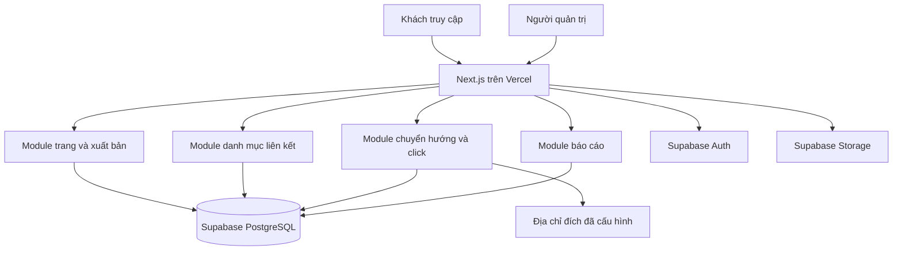

# Quy định công nghệ và kiến trúc dự án Gờ

Ngày lập: 06/11/2026.  
Trạng thái: Định hướng kỹ thuật để triển khai; chưa phải mã nguồn hoặc hạ tầng đã được thiết lập.  
Tài liệu đầu vào: [Phân tích yêu cầu](./phan-tich-yeu-cau.md).

Thiết kế dữ liệu chi tiết: [Phân tích database](./phan-tich-database.md), bao gồm từ điển dữ liệu, FK ghép, transaction, hợp đồng RPC và quyền truy cập.

## 1. Mục tiêu và phạm vi áp dụng

Chọn bộ công nghệ dễ triển khai, ít công việc quản trị máy chủ, phù hợp website thông tin có nhiều trang theo slug, giao diện quản trị và báo cáo click. Một lần triển khai ứng dụng phục vụ tất cả trang; tạo thêm trang qua quản trị không cần build hay deploy lại.

Tài liệu này quy định công nghệ, ranh giới trách nhiệm, cấu trúc thư mục và nguyên tắc triển khai. Từ “phải” là yêu cầu kỹ thuật bắt buộc; “nên” là mặc định có thể điều chỉnh khi có lý do được ghi nhận.

Các lựa chọn kỹ thuật dưới đây không tự mở rộng phạm vi chức năng trong tài liệu phân tích. Những điểm chưa được khách xác nhận vẫn cần chốt trước khi triển khai chức năng liên quan.

## 2. Bộ công nghệ thống nhất

### 2.1. Nền tảng bắt buộc

- **Next.js App Router + React + TypeScript:** xây giao diện công khai, quản trị và xử lý phía máy chủ trong cùng ứng dụng. Bật TypeScript strict.
- **Vercel:** build, hosting, HTTPS và triển khai ứng dụng từ Git; quản lý biến môi trường theo môi trường triển khai.
- **Supabase PostgreSQL:** lưu dữ liệu nghiệp vụ, quan hệ, phiên bản trang và sự kiện click.
- **Supabase Auth:** đăng nhập quản trị. Bản đầu không mở đăng ký công khai; tài khoản quản trị được cấp có kiểm soát.
- **Supabase Storage:** lưu ảnh và tài nguyên tải lên. Không lưu tệp người dùng vào filesystem của Vercel.
- **Supabase JS + `@supabase/ssr`:** truy cập dữ liệu và quản lý phiên đăng nhập theo cookie ở trình duyệt/máy chủ.
- **SQL migration qua Supabase CLI:** quản lý schema, index, function, quyền và RLS bằng mã nguồn có phiên bản.

Server Components là mặc định của giao diện App Router; chỉ dùng Client Components cho phần cần tương tác. Xem [hướng dẫn Next.js](https://nextjs.org/docs/app/getting-started/server-and-client-components) và [hướng dẫn Supabase SSR](https://supabase.com/docs/guides/auth/server-side/nextjs).

### 2.2. Thư viện và công cụ mặc định

- **pnpm:** quản lý package; commit duy nhất `pnpm-lock.yaml`.
- **Tailwind CSS + shadcn/ui:** định dạng giao diện và thành phần quản trị. Mã thành phần UI được giữ trong dự án để tùy chỉnh.
- **Zod:** kiểm tra dữ liệu ở ranh giới đầu vào, bao gồm cấu hình giao diện và khối nội dung.
- **React Hook Form:** biểu mẫu quản trị có nhiều trường hoặc cần kiểm tra tương tác.
- **dnd-kit:** sắp xếp khối và liên kết khi triển khai thao tác kéo thả; phải có cách sắp xếp dùng bàn phím.
- **ESLint + Prettier:** kiểm tra và thống nhất định dạng mã.
- **Vitest + Testing Library:** kiểm thử logic và thành phần có hành vi quan trọng.
- **Playwright:** kiểm thử các luồng đăng nhập, xuất bản, quyền truy cập và chuyển hướng click.

Chỉ cài thư viện phục vụ chức năng đang triển khai. Biểu đồ báo cáo có thể bổ sung thư viện khi xác định loại biểu đồ cần dùng.

### 2.3. Chính sách phiên bản và phụ thuộc

- Khi khởi tạo, chọn bản Next.js ổn định còn được hỗ trợ và Node.js LTS tương thích với Next.js, Vercel và các thư viện đã chọn.
- Ghi phiên bản Node.js trong `.node-version` và `package.json#engines`; ghi phiên bản pnpm trong `packageManager`. Đồng bộ local, CI và Vercel.
- Khóa phiên bản thực tế bằng lockfile; CI cài bằng `pnpm install --frozen-lockfile`. Không dùng bản canary cho production.
- Nâng major version qua thay đổi riêng, đọc hướng dẫn migration và chạy lại các kiểm thử liên quan.
- Không bổ sung ORM, backend riêng, Redis, hàng đợi hoặc hệ thống quản lý trạng thái toàn cục khi chưa có nhu cầu được chứng minh. Truy cập Supabase qua SDK và SQL RPC đủ cho bản đầu.

## 3. Kiến trúc tổng thể

Áp dụng **modular monolith**: một repository, một ứng dụng Next.js, chia module theo nghiệp vụ, một dự án Vercel cho ứng dụng. Mỗi môi trường dùng dữ liệu Supabase phù hợp.



### 3.1. Trách nhiệm từng thành phần

- **Trang công khai:** đọc phiên bản đã xuất bản, dựng nội dung theo slug và metadata chia sẻ. Không đưa dữ liệu nháp vào HTML, JSON hoặc client props công khai.
- **Quản trị:** quản lý trang, liên kết, media, bản nháp và báo cáo. Kiểm tra phiên và quyền ở máy chủ cho từng thao tác.
- **Server Actions:** nhận thay đổi từ giao diện quản trị, kiểm tra đầu vào, gọi service và trả kết quả có cấu trúc.
- **Route Handlers:** dành cho giao thức HTTP như callback đăng nhập và chuyển hướng click. Không tạo REST API nội bộ chỉ để Server Component gọi lại cùng ứng dụng.
- **Service nghiệp vụ:** xử lý quy tắc xuất bản, đổi slug, nhân bản, đồng bộ URL và thống kê.
- **Repository:** truy vấn Supabase, gọi RPC và chuyển lỗi dữ liệu thành lỗi ứng dụng; không chứa JSX.
- **PostgreSQL:** bảo đảm transaction, unique, foreign key, RLS và các ràng buộc không thể chỉ dựa vào kiểm tra giao diện.

Mặc định dùng Node.js runtime cho xử lý nghiệp vụ. Không dựa vào tiến trình chạy liên tục, bộ nhớ của một instance hoặc tác vụ nền tự phát sau khi trả response.

### 3.2. Hướng phụ thuộc

`app → feature actions/queries → services → repositories → Supabase`

- `app/` điều phối tuyến và render; không đặt SQL hay quy tắc nghiệp vụ dài trong `page.tsx`.
- Thành phần phía client chỉ import module an toàn cho trình duyệt. File truy cập dữ liệu nhạy cảm phải dùng `server-only`.
- `lib/` chứa hạ tầng dùng chung, không import ngược từ `features/`.
- Module này chỉ dùng API công khai của module khác; tránh import sâu vào repository của nhau.
- Không tạo lớp interface hoặc dependency injection cho mọi file. Chỉ tách abstraction khi có nhiều cách triển khai hoặc cần cô lập một ranh giới cụ thể.

## 4. Cấu trúc thư mục chuẩn

Đây là cấu trúc mục tiêu, sẽ được tạo dần khi triển khai. Hiện repository mới có tài liệu.

```text
gocafe.profile/
├── docs/
│   ├── phan-tich-yeu-cau.md
│   ├── quy-dinh-cong-nghe-va-kien-truc.md
│   └── decisions/                     # Quyết định thay đổi kiến trúc khi phát sinh
├── public/                           # Asset tĩnh đi cùng mã nguồn
├── src/
│   ├── app/
│   │   ├── layout.tsx                # Root layout, font và metadata chung
│   │   ├── globals.css
│   │   ├── not-found.tsx
│   │   ├── error.tsx
│   │   ├── (public)/                 # Route group, không tạo tiền tố URL
│   │   │   ├── page.tsx              # /
│   │   │   └── [slug]/page.tsx       # /gocafe, /hophuonganh...
│   │   ├── (auth)/
│   │   │   └── login/page.tsx        # /login
│   │   ├── auth/callback/route.ts
│   │   ├── admin/
│   │   │   ├── layout.tsx
│   │   │   ├── page.tsx
│   │   │   ├── pages/
│   │   │   │   ├── page.tsx
│   │   │   │   ├── new/page.tsx
│   │   │   │   └── [pageId]/
│   │   │   │       ├── edit/page.tsx
│   │   │   │       └── preview/page.tsx
│   │   │   ├── links/page.tsx
│   │   │   ├── media/page.tsx
│   │   │   └── reports/page.tsx
│   │   └── r/[pageLinkId]/route.ts   # Chuyển hướng có ghi nhận click
│   ├── features/
│   │   ├── auth/
│   │   ├── pages/
│   │   │   ├── components/          # Editor, preview, renderer theo nghiệp vụ
│   │   │   ├── actions.ts           # Server Actions, 'use server'
│   │   │   ├── queries.ts           # Điểm vào đọc dữ liệu phía server
│   │   │   ├── service.ts           # Xuất bản, nhân bản, đổi slug
│   │   │   ├── repository.ts        # Supabase query/RPC
│   │   │   ├── schemas.ts           # Zod schemas
│   │   │   ├── types.ts
│   │   │   └── service.test.ts
│   │   ├── links/
│   │   ├── media/
│   │   └── analytics/               # Ghi click và truy vấn báo cáo
│   ├── components/
│   │   ├── ui/                      # Thành phần UI cơ sở
│   │   └── shared/                  # Thành phần dùng chung nhiều nghiệp vụ
│   ├── lib/
│   │   ├── supabase/
│   │   │   ├── browser.ts           # Client cho trình duyệt
│   │   │   ├── server.ts            # Client theo cookie/request
│   │   │   ├── privileged.ts        # Secret client, chỉ dùng khi cần
│   │   │   └── session.ts           # Hỗ trợ làm mới phiên
│   │   ├── env.client.ts
│   │   ├── env.server.ts
│   │   ├── errors.ts
│   │   ├── logger.ts
│   │   └── utils.ts
│   ├── config/
│   │   ├── site.ts
│   │   ├── reserved-slugs.ts
│   │   └── themes.ts
│   ├── types/database.generated.ts  # Sinh từ schema Supabase
│   └── proxy.ts                     # Làm mới cookie phiên theo Next.js đã chọn
├── supabase/
│   ├── config.toml
│   ├── migrations/                  # SQL schema, policies, functions, indexes
│   ├── tests/                       # Kiểm tra RLS và transaction quan trọng
│   └── seed.sql                     # Dữ liệu giả lập, không chứa tài khoản thật
├── tests/e2e/
├── .github/workflows/ci.yml
├── .env.example
├── .gitignore
├── .node-version
├── next.config.ts
├── package.json
├── pnpm-lock.yaml
├── tsconfig.json
└── README.md
```

Các module khác chỉ tạo file tương ứng khi thực sự cần; không tạo thư mục rỗng cho đủ sơ đồ. `proxy.ts` theo quy ước của Next.js được chọn; nếu dùng phiên bản cũ hơn, đối chiếu tên và API trong tài liệu phiên bản đó. Proxy hỗ trợ phiên, không thay thế kiểm tra quyền trong action/query. Quy ước route group và vị trí file theo [tài liệu cấu trúc Next.js](https://nextjs.org/docs/app/getting-started/project-structure).

### 4.1. Quy tắc đặt tên

- Tên file/thư mục nghiệp vụ dùng `kebab-case`; React component export dùng `PascalCase`; hàm và biến dùng `camelCase`.
- Bảng/cột PostgreSQL dùng `snake_case`; thời gian lưu bằng `timestamptz`; định danh nghiệp vụ dùng UUID.
- Import nội bộ qua alias `@/*` trỏ đến `src/*`.
- Database types là dữ liệu sinh tự động; không sửa tay. Domain types có thể khác kiểu hàng trong database.
- Tránh file `utils.ts` hoặc `service.ts` phình to; tách theo hành vi khi cần, ví dụ `publish-page.ts`.

## 5. Thiết kế dữ liệu và xuất bản

### 5.1. Các bảng chính

- `admin_users`: ánh xạ `auth.users.id` với quyền quản trị và trạng thái hoạt động; người dùng không được tự cấp quyền.
- `pages`: định danh ổn định, tên nội bộ, trạng thái, `published_revision_id`, thời điểm lưu trữ.
- `page_slugs`: registry chung cho slug hiện tại và slug cũ; `slug` unique toàn bảng, trỏ đến `page_id`. Mỗi trang có tối đa một slug hiện tại bằng unique index có điều kiện. Cách này thay cho hai nơi lưu slug độc lập, tránh trùng giữa slug mới và alias.
- `page_revisions`: phiên bản nháp/đã xuất bản, cấu hình theme và số phiên bản để kiểm soát ghi đồng thời.
- `page_blocks`: khối nội dung theo revision, kiểu khối, thứ tự và payload JSONB đã kiểm tra schema.
- `links`: danh mục link chung, URL và nhãn mặc định, trạng thái hoạt động.
- `page_links`: định danh vị trí link ổn định, thuộc một trang và tham chiếu link gốc.
- `revision_link_placements`: vị trí trong revision/block, thứ tự và nhãn/ảnh ghi đè; tham chiếu `page_links`.
- `media_assets`: metadata và object path trong Storage.
- `click_events`: event ID, page ID, link ID, page-link ID, revision ID và thời gian xảy ra.

`audit_logs` chỉ bổ sung nếu phạm vi cần lịch sử thao tác. JSONB dành cho cấu hình và payload khối; không dùng một JSON lớn thay toàn bộ quan hệ trang–link–click.

### 5.2. Ràng buộc bắt buộc

- Bản nháp có thể chỉnh sửa; revision đã xuất bản phải bất biến. Chỉnh sửa tiếp tạo hoặc dùng một bản nháp riêng.
- Xuất bản bằng một SQL function/RPC trong transaction: xác minh quyền, kiểm tra revision, block và placement cùng thuộc trang, khóa hàng trang, rồi cập nhật con trỏ công khai.
- Dùng expected version để phát hiện hai phiên biên tập ghi đè nhau; báo xung đột cho người dùng.
- Foreign key/constraint phải ngăn revision hoặc vị trí của trang A bị gắn vào trang B; không chỉ dựa vào UUID hợp lệ.
- Chuẩn hóa slug ở server; unique constraint là chốt cuối cùng khi hai request trùng nhau. Cấm slug hệ thống, gồm `admin`, `api`, `auth`, `login`, `r`, `assets` và mọi tuyến tĩnh bổ sung.
- Đổi slug và giữ alias phải diễn ra cùng transaction. Chuyển alias thẳng đến slug hiện tại để tránh chuỗi redirect.
- Xóa mềm trang, link và vị trí đã có click; không cascade xóa lịch sử thống kê.
- Index ban đầu gồm slug unique, các foreign key thường truy vấn và click theo `(page_id, occurred_at)`, `(link_id, occurred_at)`. Điều chỉnh theo truy vấn thực tế.

### 5.3. Quy tắc cần xác nhận từ nghiệp vụ

Kiến trúc hỗ trợ nháp/xuất bản độc lập và giả định URL gốc được cập nhật tập trung: sửa URL có hiệu lực ngay trên trang đã xuất bản, còn nội dung/giao diện đi qua xuất bản. Nhãn và ảnh hiển thị được chốt vào revision khi xuất bản để tránh thay đổi ngoài ý muốn. Nếu khách yêu cầu mọi thay đổi link đều phải xuất bản lại, cần thêm phiên bản liên kết và cập nhật thiết kế trước khi lập trình.

## 6. Xác thực và quyền dữ liệu

- Phiên quản trị dùng Supabase Auth với cookie theo hướng dẫn SSR chính thức; xác minh token phía server bằng API phù hợp như `getClaims()` hoặc `getUser()`, không tin riêng dữ liệu từ `getSession()` để cấp quyền.
- Sau xác thực, kiểm tra `admin_users` còn hoạt động. Có tài khoản Auth không đồng nghĩa có quyền quản trị.
- Mọi bảng được expose qua Data API phải bật RLS và cấp SQL privileges tối thiểu. Chặn mặc định nếu chưa có policy.
- `anon` chỉ đọc tập dữ liệu công khai cần thiết của revision đang được xuất bản. Không cấp quyền đọc toàn bộ revision, báo cáo, draft, danh sách quản trị hoặc sự kiện click.
- Khi dùng view công khai, dùng `security_invoker` và policy trên bảng gốc; khi dùng RPC, giới hạn rõ dữ liệu trả về, vai trò được gọi và điều kiện công khai.
- Người quản trị dùng client theo phiên người dùng và RLS cho các thao tác thông thường. Trình duyệt không trực tiếp ghi dữ liệu nghiệp vụ ngoài luồng upload đã cấp quyền.
- Client có secret key chỉ dùng trong file `server-only`, cho đường ghi click hoặc tác vụ đặc quyền đã được giới hạn. Key này có thể vượt RLS nên service phải tự kiểm tra toàn bộ điều kiện truy cập.
- SQL function mặc định dùng quyền invoker. Nếu bắt buộc `SECURITY DEFINER`, cố định `search_path`, định danh schema rõ ràng, giới hạn `EXECUTE` và kiểm tra quyền bên trong.
- Tài nguyên nháp dùng bucket private và signed URL có hạn. Asset xuất bản chỉ đưa vào bucket public khi được chấp nhận là tài nguyên công khai; ẩn trang không thu hồi URL ảnh public đã chia sẻ.
- Giới hạn dung lượng, định dạng và quyền upload; bản đầu chỉ nhận ảnh raster được cho phép, không nhận HTML/SVG tùy ý.
- Nội dung không cho chạy JavaScript, HTML hoặc CSS tùy ý. Theme dùng token có schema, font từ danh sách hỗ trợ tiếng Việt và giới hạn giá trị.

Đối chiếu [RLS của Supabase](https://supabase.com/docs/guides/database/postgres/row-level-security) và [phân biệt publishable/secret key](https://supabase.com/docs/guides/api/api-keys). Key công khai không thay thế chính sách phân quyền dữ liệu.

## 7. Luồng đọc trang, ghi click và báo cáo

### 7.1. Hiển thị và cache

1. Nhận slug, tra registry và xác định trang.
2. Nếu là alias, chuyển đến slug hiện tại; vẫn kiểm tra trạng thái công khai.
3. Chỉ đọc revision mà `pages.published_revision_id` đang trỏ tới; không tồn tại hoặc không công khai thì trả 404.
4. Render phía server; chỉ gửi cấu hình cần thiết cho trình duyệt.

Bản đầu dùng đọc động, không cache chung dữ liệu trang trong Next.js/CDN để giảm rủi ro hiển thị sai bản hoặc còn lộ trang đã ngừng xuất bản. Khi có nhu cầu tối ưu mới thêm cache có tag và invalidation khi xuất bản, ẩn trang, đổi slug hoặc cập nhật link. Quản trị, preview và endpoint click phải luôn xử lý động, không lưu cache chia sẻ.

### 7.2. Chuyển hướng click

1. Nút HTTP(S) công khai trỏ tới `/r/{pageLinkId}` bằng thẻ `a` thông thường; không prefetch tuyến thống kê.
2. Server xác minh page-link nằm trong revision đang xuất bản, trang công khai và link còn hoạt động.
3. Lấy URL từ database, kiểm tra protocol cho phép. Không nhận `?url=` tùy ý và không chuyển đến `javascript:` hoặc `data:`.
4. Ghi event bằng UUID; dùng unique event ID để chống trùng khi retry cùng lần ghi.
5. Chuyển hướng tạm thời, dùng `Cache-Control: no-store`; không dùng redirect vĩnh viễn cho tuyến này.

Việc ghi event phải được chờ hoàn tất trong request với thời hạn giới hạn. Khi đã đọc được đích hợp lệ nhưng ghi thống kê thất bại, vẫn chuyển hướng và log lỗi; có thể mất click trong trường hợp này. Không gọi ghi dữ liệu kiểu fire-and-forget rồi giả định serverless sẽ chạy tiếp. Nếu database không đọc được đích thì trả lỗi có kiểm soát, không tự đoán URL.

Không ghi event cho `HEAD`, preview quản trị và các bot nhận biết được; đây chỉ là lọc cơ bản, không bảo đảm mọi click đều từ người thật. UUID chống retry trùng không ngăn người dùng cố tình gửi nhiều request; cần theo dõi và bổ sung giới hạn tốc độ bằng cơ chế dùng chung nếu có lạm dụng, không dựa vào bộ nhớ instance.

`tel:`/`mailto:` nếu thuộc phạm vi phải có luồng riêng: ghi nhận qua endpoint cùng origin rồi mở liên kết trực tiếp từ trình duyệt; mô tả rõ đây là lượt bấm nút, không xác nhận cuộc gọi/email thành công. Không mặc định ép mọi protocol qua HTTP redirect.

### 7.3. Báo cáo

- Tổng hợp trong PostgreSQL bằng query/RPC có quyền quản trị; không tải toàn bộ click về trình duyệt để cộng.
- Lưu UTC, hiển thị mặc định `Asia/Ho_Chi_Minh`; lọc khoảng nửa mở `[from, to)` đã chuyển từ múi giờ hiển thị.
- Nhóm theo ID trang, link và vị trí; không dùng slug hoặc nhãn làm khóa báo cáo.
- Bản đầu đọc trực tiếp từ sự kiện đã commit. Khi dữ liệu lớn mới thêm bảng tổng hợp ngày và tác vụ có thể retry an toàn.
- Không mặc định lưu IP thô hay fingerprint. Thời gian lưu event và chính sách dọn dữ liệu phải chốt trước production.

## 8. Môi trường và triển khai

### 8.1. Tách môi trường

- **Local:** Next.js chạy máy phát triển; Supabase local qua CLI/Docker, hoặc dự án development riêng nếu không dùng Docker.
- **Preview:** Vercel Preview dùng Supabase staging và dữ liệu giả lập; tuyệt đối không dùng secret hoặc dữ liệu production. Nhiều preview có thể dùng chung staging khi schema tương thích; thay đổi schema xung đột cần database/branch tách riêng.
- **Production:** tên miền chính trên Vercel, Supabase production riêng, tài khoản và dữ liệu thật.

Cấu hình redirect URL của Auth phù hợp từng môi trường; hạn chế wildcard ở production. Chọn region Vercel và Supabase gần nhau, phù hợp người dùng Việt Nam và khả năng dịch vụ tại thời điểm thiết lập. Vercel phân biệt các môi trường và phạm vi biến môi trường trong [tài liệu environments](https://vercel.com/docs/deployments/environments) và [environment variables](https://vercel.com/docs/environment-variables).

### 8.2. Biến môi trường

`.env.example` chỉ mô tả biến và giá trị minh họa, không chứa secret thật:

```dotenv
NEXT_PUBLIC_SUPABASE_URL=https://your-project.supabase.co
NEXT_PUBLIC_SUPABASE_PUBLISHABLE_KEY=your-publishable-key
SUPABASE_SECRET_KEY=server-only-secret
APP_URL=http://localhost:3000
```

- Biến có `NEXT_PUBLIC_` có thể xuất hiện trong bundle trình duyệt; tuyệt đối không đặt secret dưới tiền tố này.
- `SUPABASE_SECRET_KEY` chỉ cấp cho môi trường thực sự dùng tác vụ đặc quyền. Dự án dùng key legacy phải ánh xạ cấu hình có chủ đích, không trộn lẫn vai trò key.
- Kiểm tra biến bằng schema trong `env.client.ts`/`env.server.ts`; lỗi cấu hình phải báo rõ và không in giá trị secret.
- `.env.local`, thông tin kết nối database và credential CI không được commit. Credential migration chỉ nằm trong secret của CI hoặc máy vận hành, không cần đưa vào runtime Next.js.

### 8.3. Quy trình phát hành

1. Tạo branch và thay đổi nhỏ, dễ review. Nếu đổi schema, thêm migration mới; không sửa migration đã áp dụng.
2. CI chạy cài dependency có lockfile, lint, typecheck, test liên quan và `next build`. Chuẩn hóa script `lint`, `typecheck`, `test`, `test:e2e`, `build` khi khởi tạo mã nguồn.
3. Áp dụng migration lên staging có kiểm soát; chạy kiểm tra quyền và kiểm thử tích hợp.
4. Kiểm tra Vercel Preview: đăng nhập, biên tập, xuất bản, xem trang, mở link và báo cáo.
5. Trước production, xác nhận cơ chế sao lưu/khôi phục; áp dụng migration tương thích ngược rồi triển khai mã ứng dụng đã kiểm tra.
6. Kiểm tra nhanh sau deploy: URL công khai, quyền quản trị, ảnh và chuyển hướng. Theo dõi lỗi runtime và lỗi ghi click.

Không chạy migration production trong `next build` hoặc mỗi lần request. Rollback deployment Vercel không tự rollback database; thay đổi phá vỡ schema phải dùng nhiều bước thêm–chuyển đổi–gỡ và có phương án phục hồi riêng.

### 8.4. Vận hành và chi phí

- Dùng log Vercel cho lỗi ứng dụng và log Supabase cho lỗi database/auth; ghi request/event ID phục vụ đối chiếu, không ghi token và mật khẩu.
- Theo dõi dung lượng database/storage, băng thông ảnh, số invocation và thời gian xử lý tuyến click.
- Chọn gói dịch vụ theo điều kiện sử dụng, quota, yêu cầu sao lưu và phục hồi tại thời điểm triển khai; không mặc định gói miễn phí đáp ứng vận hành thương mại.
- Sao lưu phải bao gồm dữ liệu database và file Storage theo cơ chế riêng; kiểm tra khôi phục trên môi trường tách biệt. Chốt người chịu trách nhiệm, tần suất và mục tiêu phục hồi trước bàn giao.

## 9. Kiểm thử và tiêu chí hoàn thành kỹ thuật

Tập trung kiểm thử ranh giới có thể gây lộ dữ liệu, sai xuất bản hoặc sai thống kê:

- Người chưa đăng nhập, người có Auth nhưng không có quyền và quản trị đã bị vô hiệu hóa không đọc được draft/báo cáo hoặc sửa dữ liệu, kể cả gọi Data API/RPC trực tiếp.
- Lưu nháp không đổi bản công khai; xuất bản đồng thời nội dung, theme và thứ tự link; lỗi giữa transaction không tạo bản công khai dở dang.
- Hai thao tác xuất bản/đổi slug đồng thời không phá ràng buộc, không ghi đè im lặng và không chiếm alias đã tồn tại.
- Cùng link có 12 click từ trang A và 5 từ trang B thì báo cáo trả đúng 12, 5 và 17 trong dữ liệu kiểm thử kiểm soát.
- Preview không cộng click; link không còn thuộc bản công khai không được ghi click như vị trí đang hoạt động.
- Đã xác định được URL đích nhưng ghi click lỗi thì vẫn chuyển hướng; không tạo open redirect.
- Đổi slug/gỡ link không mất lịch sử; lọc ngày đúng ranh giới múi giờ Việt Nam.
- Tải lên đúng quyền và giới hạn; không có secret trong client bundle hoặc repository.

Không cần snapshot cho mọi component. Kiểm thử SQL/RLS thực hiện trên database kiểm thử; kiểm thử E2E dùng tài khoản và dữ liệu giả, không dùng production.

## 10. Thay đổi kiến trúc và các điểm cần chốt

Thay đổi nền tảng deploy, cơ chế xác thực, mô hình xuất bản hoặc nguồn dữ liệu phải có ghi nhận trong `docs/decisions/`: vấn đề, lựa chọn, lý do, tác động và cách chuyển đổi. Cập nhật tài liệu này cùng thay đổi triển khai.

Trước khi lập trình phần liên quan cần chốt:

1. Nháp/xuất bản và quy tắc URL gốc cập nhật ngay hay theo revision.
2. Số tài khoản quản trị, quyền thực tế và cách cấp/thu hồi tài khoản.
3. Hành vi trang chủ `/`, bộ khối nội dung và danh sách protocol liên kết.
4. Quy mô truy cập, độ trễ báo cáo chấp nhận được và thời hạn lưu click.
5. Chủ sở hữu tài khoản Vercel/Supabase, tên miền, ngân sách và trách nhiệm sao lưu.

Các lựa chọn này cần xác nhận nghiệp vụ; bộ công nghệ và cấu trúc module trong tài liệu là nền tảng để triển khai theo hướng dễ deploy đã chọn.
